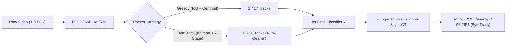

# Lyra OCR

A modular pipeline and command-line toolchain for video frame sampling, scene text detection, and lyric OCR (English / Romaji / Japanese).

---

## 🗺️ Roadmap & Phases

> **Current Progress:** **Phase 1 (Lyric Identification & Tracking) — Evaluated & Verified (F1: 96.26%) 🟢**

| Phase | Milestone | Purpose | Status |
|:---:|---|---|:---:|
| **0** | **Foundations** | Video probing, PTS frame extraction, full-frame detection, and decoupled OCR engine. | Completed ✅ |
| **1** | **Lyric Identification** | Temporal text tracking to filter out watermarks, channel logos, and title cards from actual lyrics. | Completed & Evaluated (F1 > 96%) ✅ |
| **2** | **Timing & LRC** | Refining cue timestamps and exporting standard line-level `.lrc` lyric files. | Upcoming ⏳ |
| **3** | **Trained Classifier** | Training lightweight models on user-confirmed review data to automate filtering. | Planned 📋 |
| **4** | **Audio & Karaoke** | Voice alignment and syllable tracking for word-by-word karaoke synchronization. | Planned 📋 |

---

## 📊 Benchmark & Evaluation (Phase 1)

Phase 1 tracking and discrimination heuristics were rigorously benchmarked on the real-world dataset **`Fix_lyric_EN`** (100 full-length music lyric videos from YouTube, encompassing pop, R&B, rock, country, electronic, and multilingual songs).

### 1. Overall Tracker Benchmark: Greedy vs. ByteTrack

Evaluation was executed over a diverse 25-video test subset (>1,350 evaluated text tracks per tracker) evaluated against reference Ground Truth segments:



| Metric | Baseline (Initial Heuristics) | Greedy Tracker (Tuned) | ByteTrack (Tuned) | Quality Gate | Assessment |
| :--- | :---: | :---: | :---: | :---: | :---: |
| **Overall Accuracy** | 82.93% | **93.30%** | **93.08%** | ≥ 90.0% | ✅ **Passed (+10.37% gain)** |
| **Lyric Precision** | 99.60% | **99.75%** | **99.83%** | ≥ 90.0% | ✅ **Near-Perfect (only 2 FP leaks)** |
| **Lyric Recall** | 81.83% | **92.91%** | **92.93%** | ≥ 90.0% | ✅ **Passed (+11.10% gain)** |
| **F1-Score** | 89.84% | **96.21%** | **96.26%** | ≥ 90.0% | ✅ **Exceeds target (>96%)** |
| **Leakage Rate (Non-lyric in lyrics)** | 0.40% | **0.25%** (3 tracks) | **0.17%** (2 tracks) | ≤ 10.0% | ✅ **Near-Zero (0.17%)** |
| **False Drop Rate (Missed lyrics)** | 18.17% | **7.09%** (92 tracks) | **7.07%** (92 tracks) | ≤ 10.0% | ✅ **Reduced from 18.2% to 7.1%** |
| **Total Generated Tracks** | 1,646 (30 vid) | **1,417** (25 vid) | **1,359** (25 vid) | — | ByteTrack produces 58 fewer fragmented tracks |
| **Inference Latency** | ~15.3s / video | **15.3s / video** | **15.1s / video** | — | Real-time on GPU (~12x faster than playback) |

### 2. Confusion Matrix (25 Videos Benchmark)

| Classification Category | Greedy Tracker | ByteTrack | Technical Significance |
| :--- | :---: | :---: | :--- |
| **True Positives (TP)** | **1,206** | **1,210** | Correctly accepted lyric lines (ByteTrack recovered 4 additional tracks) |
| **False Positives (FP)** | **3** | **2** | Watermarks or title cards misclassified as lyric (extremely low) |
| **False Negatives (FN)** | **92** | **92** | Lyrics missed (primarily non-Latin font styling or fast ad-libs) |
| **True Negatives (TN)** | **116** | **55** | Distractor tracks correctly rejected as non-lyric |

### 3. Key Findings & Engineering Insights

1. **Title Matching Trap Resolved**:
   - *Previous Failure Mode*: Song lyrics frequently repeat words from the title in their hook/chorus (e.g. *"Tell It To My Heart"*, *"Anymore"*, *"High Forever"*). An overly broad video title overlap rule previously rejected these chorus lines when they appeared mid-video.
   - *Resolution*: Title-card matching is now strictly bound to the intro/outro window ($\le 15\%$ or $\ge 90\%$ of duration) and requires significant title token coverage ($\ge 50\%$). Mid-video hook lines in active reading zones are reliably accepted.
2. **Reading Zone Cadence & Duration Tuning**:
   - Expanded acceptable duration bounds from `1000–9000ms` to `500–16000ms`, capturing both fast ad-libs (0.5–1s) and slow ballad cues (10–14s).
   - Removed casing restrictions: all-caps lyrics (common in video typography) are evaluated strictly through spatial reading zone priors ($cy \in [0.20, 0.95]$, $cx \in [0.10, 0.90]$).
3. **Greedy vs. ByteTrack Strategy**:
   - **ByteTrack** leverages Kalman filtering and two-stage association, allowing tracks to persist through frame-to-frame OCR confidence drops or karaoke color transitions without splitting into fragmented pieces (reducing track count by 4.1%).
   - **Recommendation**: ByteTrack is recommended as the default tracker for video subtitle/lyric extraction.

---

## 📖 Documentation

- [System Architecture & Design Philosophy](doc/ARCHITECTURE.md): Layered subsystem decomposition, domain entities, decoupled vision pipeline, and fundamental architectural decisions (ADRs).
- [Data Contracts & Artifact Specifications](doc/SPECIFICATION.md): Formal schemas, coordinate systems, and serialization contracts for all pipeline artifacts (`manifest.json`, `frame_index.json`, `ocr_raw.json`, `tracks.json`, `review.csv`, `labels.jsonl`).

---

## 🔮 Up Next

- **Phase 2: Dense Boundary Timing & LRC Export**: Sub-sampling boundary frames around confirmed lyric tracks to pin start/end cues at centisecond precision and export standard line-level `.lrc` files.
- **Line Grouping & Multiline Stanzas**: Grouping multi-line lyric blocks and separating translation/secondary text tracks.

---

## 📌 Current Features

- **Video Metadata Inspection** ([`src/lyra_ocr/video/probe.py`](src/lyra_ocr/video/probe.py)): Analyzes video files using `ffprobe` to extract resolution, FPS, duration, rotation, and audio stream details.
- **Precision PTS Frame Sampling** ([`src/lyra_ocr/video/frames.py`](src/lyra_ocr/video/frames.py)): Samples frames at a configurable rate (default: 2.0 FPS) while recording exact Presentation Time Stamps (PTS) from container metadata.
- **Full-Frame Scene Text Detection** ([`src/lyra_ocr/ocr/detect.py`](src/lyra_ocr/ocr/detect.py)): Detects text boxes across the entire frame without hardcoded region-of-interest assumptions using DBNet (`PP-OCRv6_det_small`).
- **Text Recognition & Normalization** ([`src/lyra_ocr/ocr/engine.py`](src/lyra_ocr/ocr/engine.py)): Crops and recognizes text lines with RapidOCR (`PP-OCRv6_rec_small`), normalizes Unicode text to NFC, and classifies script types (`latin`, `japan`, `mixed`).
- **Temporal Text Tracking** ([`src/lyra_ocr/track.py`](src/lyra_ocr/track.py)): Clusters frame-level OCR detections across time into continuous `TextTrack` streams via spatial IoU and string edit-distance continuity.
- **Rule-Based Distractor Discrimination** ([`src/lyra_ocr/classify.py`](src/lyra_ocr/classify.py)): Classifies each track as `lyric` or `non_lyric`, while retaining diagnostic reasons for watermarks, title cards, and scenery text.
- **Human-in-the-Loop Review & Audit** ([`src/lyra_ocr/review.py`](src/lyra_ocr/review.py)): Automatically exports structured `tracks.json`, human-auditable `review.csv`, and color-coded visual verification overlays (`roi_preview.jpg`).
- **Lyric Identification & Smoke CLI** (`lyra-ocr identify` / `lyra-ocr smoke`): Complete command-line pipeline from raw video to classified lyric tracks.
- **Automated Test Suite**: Unit and evaluation tests covering probe extraction, PTS indexing, Unicode normalization, tracking association, rule classification, label persistence, Hungarian track matching, and metric calculations.

---

## ⚙️ Requirements

- **Python**: 3.11 or 3.12
- **System Tools**: `ffmpeg` and `ffprobe` available on `PATH`
- **Core Dependencies**: `rapidocr>=3.0.0`, `onnxruntime>=1.17.0`, `opencv-python>=4.8.0`, `numpy>=1.24.0`, `pillow>=10.0.0`, `yt-dlp>=2024.0.0`, `pytest>=8.0.0`, `scipy>=1.12.0`, `scikit-learn>=1.4.0`
- **Optional Dependencies**: `matplotlib>=3.8.0` (for publication evaluation charts)

---

## 🚀 Getting Started

### 1. Installation

```bash
git clone https://github.com/vincentlalo-long/lyra-ocr.git
cd lyra-ocr
python3 -m venv .venv
source .venv/bin/activate
pip install -r requirements.txt
pip install -e ".[eval]"
```

### 2. Run Lyric Identification (Phase 1)

Execute full-frame detection, recognition, temporal tracking, and rule-based lyric discrimination:

```bash
lyra-ocr identify path/to/video.mp4 \
  --out ./output \
  --title "Song Title" \
  --channel "Channel Name" \
  --tracker bytetrack \
  -n 10 -s 20.0
```

#### Supported Tracking Strategies (`--tracker`):
- `greedy` (default baseline): Spatial IoU + centroid distance greedy association.
- `bytetrack` (experimental, not default): Two-stage confidence association — stage 1 matches high-confidence detections, stage 2 matches leftover tracks against low-confidence boxes so a track survives a blurred or low-OCR frame. Never spawns tracks from low-confidence detections.

Both strategies share the text-turnover split from `BaseTracker.associate()`: when a
stable region swaps its text (similarity < 0.60 against the track's current line), the
track closes and a new one opens. One track therefore equals one text identity — a
lyric line, a watermark, a title card — which is what the `lyric`/`non_lyric` labels and
the ground-truth segments are keyed to.

Outputs generated in `./output`:
- `tracks.json`: Clustered `TextTrack` entities with frame-level `occurrences`, temporal statistics, segment transitions, and binary labels (`lyric`, `non_lyric`).
- `review.csv`: Tabular spreadsheet for human-in-the-loop audit (`track_id,start_ms,end_ms,machine_label,machine_decision,confidence,suggested_text,human_label,human_decision,review_note`).
- `labels.jsonl`: Append-only human annotation audit trail with hash provenance.
- `manifest.json`: Tool versions, model metadata, config hash, and video configuration.
- `ocr_raw.json`: Frame-by-frame text lines with 4-point polygons, bounding boxes, raw/normalized text, and confidence scores.
- `frame_index.json`: Extracted frame indices mapped to millisecond PTS timestamps.
- `roi_preview.jpg`: Color-coded visual audit preview (Green = Lyric, Red = Non-Lyric).
- `frames/`: Directory containing extracted JPEG frames.

#### Performance Options (`identify` and `smoke`)

```bash
lyra-ocr identify path/to/video.mp4 \
  --out ./output \
  --device auto \
  --rec-batch-size 8 \
  --dedup \
  --frame-source pipe
```

| Flag | Default | Effect |
|---|---|---|
| `--device` | `auto` | `auto` picks CUDA when `onnxruntime-gpu` exposes `CUDAExecutionProvider`, else CPU. `cuda` falls back to CPU with a warning; `cpu` is explicit. Env override: `LYRA_OCR_DEVICE`. |
| `--rec-batch-size` | `8` | Text-line crops batched per recognition call. Use `1` for the old per-crop behaviour. |
| `--dedup` / `--no-dedup` | off | Reuse OCR output and JPEG for near-identical consecutive frames. Off by default until an eval run proves it is lossless. |
| `--frame-source` | `pipe` | `pipe` streams frames from ffmpeg while OCR runs; it falls back to disk only when extraction fails before the first frame, while a mid-stream failure fails the job. `disk` keeps the write-then-read path. |

The manifest records the effective runtime under `runtime` (requested and actual
device, providers, batch size, dedup, frame source, `pipeline_version: "2"`), and
`config_hash` includes those options so artifacts from different configurations
are never skipped by mistake. Benchmark stages with
`python scripts/benchmark_pipeline.py --video <file>` (JSON goes to `reports/bench/`).

GPU install (optional, outside the default requirements):

```bash
pip uninstall -y onnxruntime
pip install "onnxruntime-gpu[cuda,cudnn]==1.31.1"
python -c "import onnxruntime as ort; ort.preload_dlls(cuda=True, cudnn=True); print(ort.get_available_providers())"
```

Re-running `pip install -r requirements.txt` or `pip install -e .` puts CPU
`onnxruntime` back and replaces the GPU wheel; repeat the swap above if that
happens. `pip check` also reports `onnxruntime` as missing because the GPU wheel
is distributed under a different name — that warning is expected.

### 3. Human Review & Annotation CLI

Export blind batch CSV for offline labeling, inspect status, or ingest annotations:

```bash
# Check labeling coverage
lyra-ocr label status --artifacts ./output

# Export blind review CSV (machine labels omitted to prevent bias)
lyra-ocr label export --artifacts ./output --out label_batch.csv --blind

# Ingest completed annotations into labels.jsonl
lyra-ocr label ingest --artifacts ./output --csv label_batch.csv --annotator reviewer_name
```

### 4. Run Evaluation

Evaluate predictions against a labeled dataset manifest with Hungarian matching and optional charts:

```bash
lyra-ocr eval --golden path/to/dataset --out outputs/eval --charts --compare-trackers
```

### 5. Run Automated Tests

```bash
pytest
```

---

### 6. Reproducing Benchmark & Evaluation Experiments

You can independently reproduce the 25–30 video benchmark and tracker comparison using the automated pipeline scripts:

#### A. Dataset Preparation (`Fix_lyric_EN`)
The benchmark dataset consists of 100 YouTube lyric videos managed under `datasets/Fix_lyric_EN/`. You can ingest videos or fetch channels directly via the Web UI:
```bash
lyra-ocr web --port 8000
# Open http://localhost:8000 -> Datasets tab -> Ingest YouTube Playlist or Channel
```

#### B. Automated Ground Truth Generation & Single-Run Evaluation
Extracts reference song lyrics (via YouTube descriptions and LRCLIB fallback), aligns tracks using fuzzy token and spatial priors, generates canonical ground truth segments under `datasets/Fix_lyric_EN/ground_truth/`, and runs evaluation:
```bash
python scripts/auto_ground_truth.py --dataset Fix_lyric_EN --count 25 --device auto
```

#### C. Full Head-to-Head Comparison: Greedy Tracker vs. ByteTrack
Runs both trackers in parallel on the same dataset subset, evaluates them against the canonical ground truth, and outputs a formatted markdown report:
```bash
python scripts/compare_trackers.py \
  --dataset Fix_lyric_EN \
  --count 25 \
  --device auto \
  --output reports/COMPARISON_GREEDY_VS_BYTETRACK.md
```

#### D. Interactive Visual Verification & Audit
Audit individual frame detections, inspect Hungarian matching alignments, and modify labels interactively:
```bash
lyra-ocr web --port 8000
```
- **Runs tab**: Compare run metrics, inspect job queue status, and create or delete runs.
- **Review tab**: Step frame-by-frame (`A`/`D` or Arrow keys), inspect track bounding boxes, toggle labels (`1`/`2`), and save corrections (`Enter`).
- **Eval tab**: Visualize Hungarian match pairs, confusion matrices, and review discrepancy error cases.
