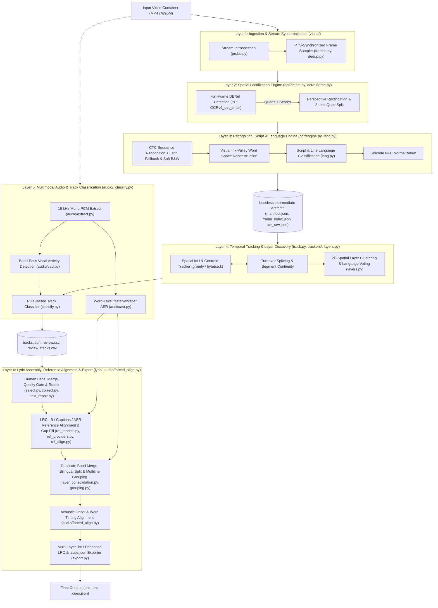
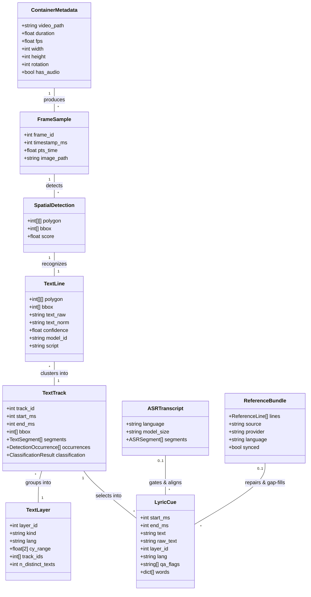
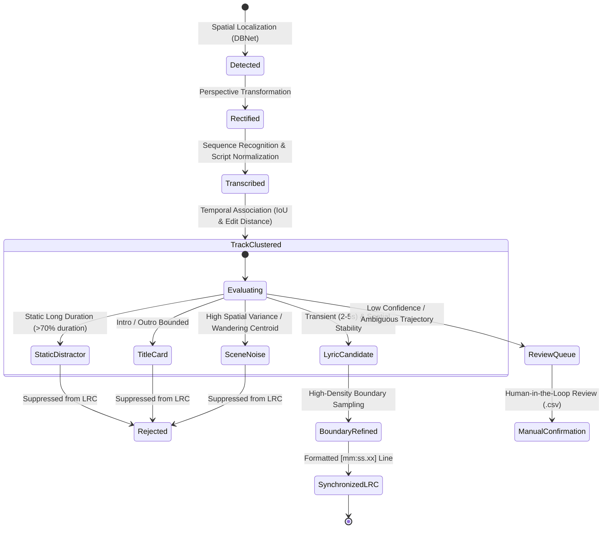

# Lyra OCR — System Architecture & Design Philosophy

## 1. Architectural Context & Problem Statement

**Lyra OCR** is an automated, layout-agnostic computer vision pipeline engineered to transcribe hardcoded lyrics from music videos and export synchronized lyric assets (`.lrc`).

### The Challenge of Music Video Lyric Extraction
Conventional subtitle extraction systems rely on strict spatial heuristics, assuming text resides statically within the lower third of broadcast video. Music videos fundamentally violate these assumptions:
- **Dynamic Placement**: Lyrics appear in arbitrary layouts—centered, top-aligned, floating, stacked vertically, or moving across scene cuts.
- **Visual Distractors**: Music video frames frequently contain persistent visual noise, including artist/channel watermarks, introductory title cards, social media tags, subscribe animations, and natural scene text.
- **Timing Inconsistencies**: Web-compressed containers and variable frame rate (VFR) encodes cause naive frame-index timing to drift cumulatively relative to the master audio stream.

Lyra OCR resolves these challenges through a **two-stage, layout-agnostic, and temporal-first architecture** designed for deterministic execution on consumer-grade CPU infrastructure.

---

## 2. Layered Architecture & Subsystem Decomposition

The system is decomposed into six architectural layers backed by centralized frozen threshold configurations (`src/lyra_ocr/config.py`). Each layer operates through strict, serializable data boundaries to ensure isolation, modularity, and reproducible pipeline stages:

### 2.1. Ingestion & Stream Synchronization Subsystem (`video/`)
- **Stream Introspection (`video/probe.py`)**: Validates video container health, stream codecs, rotational flags, resolution, duration, and audio presence.
- **PTS-Synchronized Frame Extraction (`video/frames.py`, `video/dedup.py`)**: Streams or extracts coarse frame samples at defined temporal intervals (default: 2.0 FPS / 500 ms in smoke/build workflows, 1.0 FPS default in `run_phase1_pipeline`) while capturing exact Presentation Time Stamps (PTS) directly from the container stream, with optional perceptual frame deduplication (`dedup.py`).
- **Source Acquisition (`video/downloader.py`)**: Optional YouTube/media acquisition helper for dataset and UI workflows.

### 2.2. Spatial Localization Engine (`ocr/detect.py`, `ocr/runtime.py`)
- **Full-Frame DBNet Inference**: Executes text detection across the complete 100% canvas without spatial cropping assumptions (`PP-OCRv6_det_small`).
- **Convex Quadrilateral Representation**: Emits oriented 4-point convex polygons (`polygon`) and axis-aligned bounding rectangles (`bbox`) to preserve slanted or stylized typography.
- **Perspective Rectification & Multi-Line Splitting**: Transforms oriented 4-point bounding quadrilaterals into standardized, horizontal image crops (`crop_quad`) and splits tall merged 2-line quads along horizontal gradient valleys (`split_multiline_crop_quads`).
- **Runtime Selection (`ocr/runtime.py`)**: Resolves ONNX Runtime providers (`CPUExecutionProvider`, CUDA fallback to CPU) and recognition batching (`rec_batch_size`).

### 2.3. Text Recognition, Normalization & Language Subsystem (`ocr/engine.py`, `lang.py`)
- **Decoupled Recognition & Fallbacks (`ocr/engine.py`)**: Runs `PP-OCRv6_rec_small` on preprocessed crops (upscaling, subtle CLAHE, border padding), routes low-confidence or unspaced Latin crops to `latin_PP-OCRv5_rec_mobile`, retries low-confidence crops using color-invariant soft B&W stroke normalization (`to_soft_bw_stroke_crop`), and reconstructs missing Latin word spaces from vertical ink-density valleys (`reconstruct_visual_word_spaces`).
- **Canonical Unicode Normalization (`ocr/engine.py`)**: Strips zero-width characters and normalizes recognized strings using Unicode Normalization Form C (`NFC`).
- **Coarse Script vs. Fine-Grained Language Detection (`ocr/engine.py`, `lang.py`)**: `detect_script()` tags OCR boxes by coarse script family (`latin`, `japan`, `mixed`, `empty`), while `lang.py` (`detect_line_lang`, `romaji_score`, `vote_layer_lang`) classifies tracks and spatial layers into `en`, `ja`, `ja-Latn`, `es`, `vi`, `zh`, `ko`, or `und`.

### 2.4. Temporal Tracking & Spatial Layer Discovery (`track.py`, `trackers/`, `layers.py`)
- **Cross-Frame Trajectory Clustering (`track.py`, `trackers/base.py`, `trackers/greedy.py`, `trackers/bytetrack.py`)**: Matches bounding geometries across consecutive frames using spatial Intersection-over-Union (IoU) and centroid proximity.
- **String Turnover Splitting**: `BaseTracker.associate()` closes a track and opens a successor when incoming text similarity drops below `TURNOVER_SPLIT_SIMILARITY` (`0.60`), preserving one text identity per `TextTrack`, followed by `merge_fragmented_tracks()`.
- **Spatial Layer Discovery (`layers.py`)**: Clusters tracks into horizontal `TextLayer` bands (`discover_layers`, `refresh_dict_tracks_layers`) and classifies each layer as `lyric`, `overlay`, or `sparse` with a voted dominant `lang`.

### 2.5. Multimodal Audio & Track Classification Subsystem (`audio/`, `classify.py`)
- **Audio Extraction & Vocal Separation (`audio/extract.py`)**: Extracts 16 kHz mono float32 PCM (`extract_audio_16k`, cached to `audio_16k.npy`) via FFmpeg and optionally invokes Demucs (`separate_vocals_demucs`).
- **Vocal Activity Detection (`audio/vad.py`)**: Applies a 4th-order Butterworth band-pass filter (300–3400 Hz) to compute a 50 ms vocal probability profile (`compute_vocal_activity_profile`, `vocal_active_ratio`) used to reject silent intro/outro overlays and silent gap-fill candidates.
- **Word-Level ASR (`audio/asr.py`)**: Runs `faster-whisper` with `word_timestamps=True` and `vad_filter=True` (`transcribe_audio_words`, cached to `asr_transcript.json`), supplying vocal gating (`asr_vocal_gate_score`), duplicate split onset checks (`asr_has_new_prefix_onset`), multi-line DP partitioning (`align_multiline_cues_with_asr`), and fallback reference bundles (`asr_to_reference_bundle`).
- **Discriminative Rule Classification (`classify.py`)**: Classifies `TextTrack` entities into `lyric` vs `non_lyric` using spatial priors, channel/title metadata correlation, VAD vocal activity, intro credit patterns, and layer membership, preserving diagnostic subtypes in `reason` and `qa_flags`.

### 2.6. Lyric Assembly, Reference Alignment & Export Subsystem (`lyric/`, `audio/forced_align.py`, `config.py`)
- **Centralized Threshold Configuration (`config.py`)**: Houses immutable frozen dataclasses (`LayerDiscoveryThresholds`, `GroupingThresholds`, `ClassificationThresholds`, `OcrPreprocessThresholds`) consumed by `layers.py`, `lyric/grouping.py`, `lyric/layer_consolidation.py`, `classify.py`, and `ocr/engine.py`.
- **Cue Selection & Conservative Repair (`lyric/select.py`, `lyric/correct.py`, `lyric/text_repair.py`)**: Merges human labels (`labels.jsonl`), performs non-lyric reference rescue, applies confidence/readability gates (`_quality_gate`), computes consensus medoids, and runs corpus + SymSpell English repair (`repair_text`) while keeping non-English and Romaji lines screen-faithful by default.
- **Modular Reference Subsystem (`lyric/reference.py`, `lyric/ref_models.py`, `lyric/ref_providers.py`, `lyric/ref_align.py`, `lyric/captions.py`)**: Queries LRCLIB and YouTube captions with SHA-1 disk caching (`reference_cache/`), runs monotonic many-to-many DP alignment (`align_reference`), splits overlapping reference-backed intervals (`reconcile_reference_overlaps`), and inserts VAD-checked gap fills (`fill_reference_gaps`).
- **Layer Consolidation & Grouping (`lyric/layer_consolidation.py`, `lyric/grouping.py`)**: Collapses duplicate spatial bands (`merge_duplicate_layers`), separates parallel bilingual streams or filters secondary overlays (`consolidate_language_layers`), collapses same-Y flicker, resolves simultaneous multi-line cues via short-wrap merging or ASR alignment (`resolve_simultaneous_multiline_cues`), deduplicates fade transitions (`dedupe_and_group`), and shares solitary English cues across major layers (`share_solitary_cross_layer_cues`).
- **Boundary & Acoustic Timing Alignment (`lyric/timing.py`, `audio/forced_align.py`)**: Optionally refines video boundaries (`refine_timings`) and snaps cue start times via 10 ms vocal-band onset envelopes while generating proportional word-level timings (`align_cues_with_audio`).
- **Multi-Layer LRC & JSON Export (`lyric/export.py`, `lyric/build.py`)**: Emits `.cues.json` (`write_cues_json`), primary `<name>.lrc`, per-language `<name>.<lang>.lrc` sidecars (`write_lrc_layers`), and optional Enhanced LRC `<mm:ss.xx>` word tags.

---

## 3. Domain Model & Information Architecture

The architecture structures data into explicit domain entities as it traverses the pipeline:

---

## 4. Fundamental Architectural Decisions (ADRs)

### 4.1. Layout-Agnostic Full-Frame Detection over Hardcoded ROI
* **Conventional Subtitle OCR Approach**: Crop the lower 30%–40% of the video canvas to limit inference to the expected subtitle band.
* **Failure Mode in Music Videos**: High failure rate when typography is centered, top-aligned, floating, or placed in side margins.
* **Lyra OCR Decision**: Inspect the entire frame canvas (100% full-frame) with DBNet (`PP-OCRv6_det_small`). Full-frame localization guarantees complete layout agnosticism, shifting the responsibility of layout discrimination to the temporal tracking layer.

### 4.2. Temporal Persistence as the Primary Discriminator
* **The Single-Frame Ambiguity Problem**: An OCR engine inspecting an isolated frame cannot reliably distinguish between a short lyric phrase (`"CAN YOU HEAR ME"`), a persistent channel watermark (`"OFFICIAL AUDIO"`), or a title card (`"TRACK 01"`).
* **The Temporal Discriminator Solution**: The time domain serves as the primary filter:
  - **Stationary Distractors** (logos, channel tags) exhibit zero spatial drift and indefinite duration (>70% of stream length).
  - **Title Cards** remain static but exist strictly during intro/outro boundaries (<5% of stream length).
  - **Dynamic Scene Text** exhibits erratic trajectories tied to camera pans and zoom transformations.
  - **Lyrics** remain within bounded spatial tracks, persisting for 2–5 seconds per line before advancing to the next phrase.

### 4.3. Native Container Presentation Time Stamp (PTS) vs. Frame Indexing
* **Conventional Frame Counting**: Calculate timestamp via `t = frame_index / nominal_fps`.
* **Failure Mode**: In variable frame rate (VFR) containers, web-optimized MP4 streams, and telecined video, dropped or repeated frames create cumulative timing drift, leading to out-of-sync lyrics.
* **Lyra OCR Decision**: Parse exact Presentation Time Stamps (`pts_time`) directly from container packet headers via FFmpeg's `showinfo` filter. Timestamps are stored throughout the system as integer milliseconds (`timestamp_ms`), eliminating float precision loss and frame-counting drift.

### 4.4. Decoupled Two-Stage Vision Engine
* **Coupled Architecture**: End-to-end OCR engines that detect and recognize text in a single black-box pass.
* **Failure Mode**: Inability to tune detection sensitivity independently of character recognition, difficult crop inspection, and inability to swap recognition engines for distinct scripts.
* **Lyra OCR Decision**: Strict decoupling between Spatial Detection and Text Recognition:
  - Detection produces purely spatial primitives (`Detection(polygon, bbox, score)`).
  - Perspective transformation isolates and rectifies crops into canonical horizontal orientations.
  - Recognition processes image patches independently, enabling script-specific routing and normalization without altering upstream localization.

### 4.5. Lossless Intermediate Artifacts & Two-Pass Execution
* **Monolithic Pipeline Problem**: Intertwining vision inference with temporal heuristics forces full re-computation of computer vision tasks whenever heuristic rules are modified.
* **Lyra OCR Decision**: Persist structured, schema-validated artifacts (`manifest.json`, `frame_index.json`, `ocr_raw.json`) before temporal tracking begins. This allows rapid iterative refinement of tracking and classification logic on serialized JSON data in seconds, without re-running heavy inference passes.

### 4.6. Source Layout: Cohesive Subsystem Package vs Single-Purpose Module
* **Layout Problem**: A flat module list becomes unreadable as subsystems grow, while premature packaging buries single-purpose modules under a directory that contains one file.
* **Lyra OCR Decision**: A subsystem with more than one cooperating module becomes a package (`video/`, `ocr/`, `trackers/`, `audio/`, `lyric/`, `dataset/`, `eval/`, `web/`); single-purpose domain and configuration modules stay flat at the package root (`config.py`, `lang.py`, `layers.py`, `track.py`, `classify.py`, `labels.py`, `review.py`, `provenance.py`, `pipeline.py`). Flat modules form the domain core and shared schemas, while packages isolate adapters, multimodal engines, lyric post-processing, and tooling:
  - `src/lyra_ocr/config.py`: Centralized frozen threshold dataclasses (`LayerDiscoveryThresholds`, `GroupingThresholds`, `ClassificationThresholds`, `OcrPreprocessThresholds`).
  - `src/lyra_ocr/audio/`: `extract.py` (16 kHz PCM & Demucs wrapper), `vad.py` (band-pass vocal activity profile), `asr.py` (`faster-whisper` word ASR, vocal gate, prefix onset, multi-line DP alignment), `forced_align.py` (10 ms onset alignment & proportional word timings).
  - `src/lyra_ocr/lyric/`: `models.py` (`LyricCue`, `LrcMetadata`, `CorrectionConfig`, `ReferenceConfig`), `select.py`, `correct.py`, `text_repair.py`, `reference.py` (facade over `ref_models.py`, `ref_providers.py`, `ref_align.py`), `captions.py`, `layer_consolidation.py`, `grouping.py`, `timing.py`, `export.py`, `build.py`.
* **Dependency Direction**: `cli.py` and `web/` are entry points and may import anything; domain modules never import from `cli.py`. Shared artifact metadata lives in `provenance.py`, not in the CLI.

### 4.7. Track Identity Is Text Identity, Not Position
* **Association Problem**: Karaoke and subtitle renderers reuse one fixed region for every line, so spatial association alone binds consecutive lyrics into a single track. Measured on a synthetic fixture: three different texts in the same box produced one 11-second track with one label and one ground-truth segment.
* **Lyra OCR Decision**: `BaseTracker.associate()` closes a track and opens a successor whenever the incoming text scores below `TURNOVER_SPLIT_SIMILARITY` (0.60) against the track's current segment. Both strategies inherit it, so a `TextTrack` means one text identity and is the unit that human labels, ground-truth segments and eval matching attach to. OCR jitter stays above the threshold (measured 0.96+), so it does not fragment a line.
* **Classifier Consequence**: Rules that read intra-track turnover (`distinct_text_changes >= 2`) as lyric evidence no longer fire; position alone also stopped being a sufficient title-card signal because a split track's first lyric cue legitimately starts at t≈0. Card-shaped text (`classify.looks_like_card`) is the discriminator instead.

### 4.8. Centralized Frozen Threshold Configuration (`config.py`)
* **Configuration Drift Problem**: Scattering magic numbers across `layers.py`, `classify.py`, `ocr/engine.py`, `lyric/grouping.py`, and `lyric/layer_consolidation.py` makes tuning opaque and forces callers to edit algorithm code for sensitivity sweeps.
* **Lyra OCR Decision**: Every tunable stage reads from an immutable frozen dataclass (`LayerDiscoveryThresholds`, `GroupingThresholds`, `ClassificationThresholds`, `OcrPreprocessThresholds`) in `src/lyra_ocr/config.py`, with module-level `DEFAULT_*` instances and optional keyword overrides on public functions.

### 4.9. Facade-Backed Reference & Layer Consolidation Decomposition
* **Monolith Problem**: Combining data models/caching, LRCLIB HTTP queries, and monotonic DP alignment in a single file—or mixing cross-layer consolidation with within-layer cue deduplication—creates circular dependencies and bloated modules.
* **Lyra OCR Decision**:
  - `lyric/reference.py` is preserved as a backwards-compatible re-export facade over three focused submodules: `lyric/ref_models.py` (schemas, query parsing, SHA-1 cache, similarity stats), `lyric/ref_providers.py` (LRCLIB search, `pykakasi` romanization, language selection), and `lyric/ref_align.py` (DP alignment, overlap splitting, VAD-checked gap filling).
  - `lyric/layer_consolidation.py` isolates cross-layer operations (`merge_duplicate_layers`, `consolidate_language_layers`, parallel bilingual separation, `share_solitary_cross_layer_cues`) from within-layer deduplication and simultaneous multi-line resolution in `lyric/grouping.py`.

### 4.10. Screen-Faithful Extraction for Non-English & Romaji by Default
* **Over-Correction Problem**: Applying an English frequency dictionary or aggressive romanized reference replacement to Japanese Romaji (`ja-Latn`), Spanish (`es`), Vietnamese (`vi`), or CJK (`ja`, `zh`, `ko`) lines corrupts valid lyrics and ateji readings.
* **Lyra OCR Decision**: English-only lexicon checks and SymSpell repair (`lyric/text_repair.py`) are gated to `en`, while `ReferenceConfig.repair_romaji` and `CorrectionConfig.repair_romaji` default to `False` so on-screen Romaji is preserved verbatim unless explicitly opted in. See [LANGUAGE_SUPPORT.md](LANGUAGE_SUPPORT.md) for the full language policy matrix.

---

## 5. Temporal Entity Lifecycle & State Transitions

A detected piece of visual text advances through a deterministic state machine before being accepted into the synchronized lyric track:

---

## 6. Operational Characteristics & Deployment Profile

| Operational Metric | Architecture Target | Realized Baseline (Phase 0) |
|---|---|---|
| **Hardware Requirement** | Commodity Multi-core CPU (no GPU mandatory) | Fully verified on x86_64 CPU (ONNX Runtime) |
| **Inference Throughput** | ≥ 2.0 frames per second | ~2.8 frames per second (360 ms / frame average) |
| **Memory Footprint** | < 1.5 GB resident set size (RSS) | ~650 MB peak during full-frame DBNet inference |
| **Temporal Accuracy** | Millisecond container fidelity | Strict Presentation Time Stamp (PTS) extraction |
| **Data Contract Governance** | Versioned JSON schemas | Automated unit validation in test suite |
