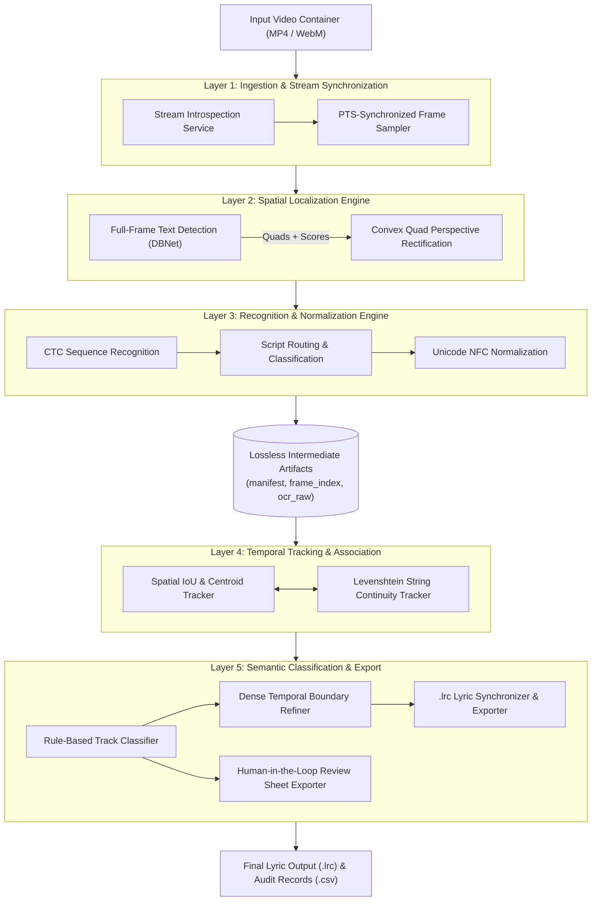
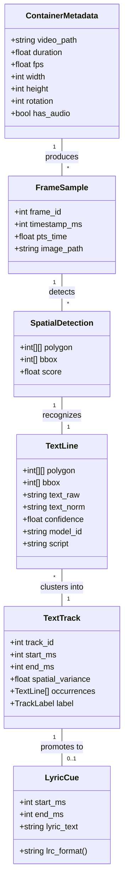
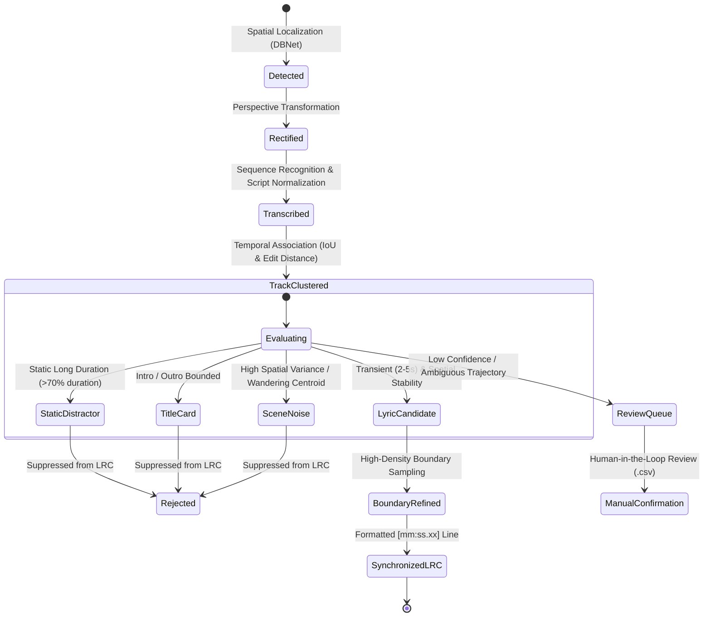

# Lyra OCR — System Architecture & Design Philosophy

## 1. Architectural Context & Problem Statement

**Lyra OCR** is an automated, layout-agnostic computer vision pipeline engineered to transcribe hardcoded lyrics from music videos and export synchronized lyric assets (`.lrc`).

### The Challenge of Music Video Lyric Extraction
Conventional subtitle extraction systems rely on strict spatial heuristics, assuming text resides statically within the lower third of broadcast video. Music videos fundamentally violate these assumptions:
- **Dynamic Placement**: Lyrics appear in arbitrary layouts—centered, top-aligned, floating, stacked vertically, or moving across scene cuts.
- **Visual Distractors**: Music video frames frequently contain persistent visual noise, including artist/channel watermarks, introductory title cards, social media tags, subscribe animations, and natural scene text.
- **Timing Inconsistencies**: Web-compressed containers and variable frame rate (VFR) encodes cause naive frame-index timing to drift cumulatively relative to the master audio stream.

Lyra OCR resolves these challenges through a **two-stage, layout-agnostic, and temporal-first architecture** designed for deterministic execution on consumer-grade CPU infrastructure.

---

## 2. Layered Architecture & Subsystem Decomposition

The system is decomposed into five distinct architectural layers. Each layer operates through strict, serializable data boundaries to ensure isolation, modularity, and reproducible pipeline stages:

### 2.1. Ingestion & Stream Synchronization Subsystem
- **Stream Introspection**: Validates video container health, stream codecs, rotational flags, resolution, duration, and audio presence.
- **PTS-Synchronized Frame Extraction**: Emits coarse frame samples at defined temporal intervals (default: 2.0 FPS / 500 ms) while decoding and capturing exact Presentation Time Stamps (PTS) directly from the container stream.

### 2.2. Spatial Localization Engine
- **Full-Frame DBNet Inference**: Executes text detection across the complete 100% canvas without spatial cropping assumptions.
- **Convex Quadrilateral Representation**: Emits oriented 4-point convex polygons (`polygon`) and axis-aligned bounding rectangles (`bbox`) to preserve slanted or stylized typography.
- **Perspective Rectification**: Transforms oriented 4-point bounding quadrilaterals into standardized, horizontal image crops for downstream recognition.

### 2.3. Text Recognition & Normalization Subsystem
- **Decoupled Recognition**: Ingests cropped text line patches independently of the detection engine.
- **Script Classification**: Inspects Unicode code point distributions to label recognized text lines by script family (`latin`, `japan`, `mixed`, `empty`).
- **Canonical Unicode Normalization**: Normalizes all extracted strings using Unicode Normalization Form C (`NFC`), eliminating composite character inconsistencies.

### 2.4. Temporal Tracking & Association Subsystem
- **Cross-Frame Trajectory Clustering**: Matches bounding geometries across consecutive frames using spatial Intersection-over-Union (IoU) and centroid proximity.
- **String Distance Continuity**: Incorporates normalized Levenshtein edit distance to link changing text occurrences into continuous `TextTrack` streams over time.

### 2.5. Semantic Classification & Output Subsystem
- **Discriminative Rule Classification**: Classifies `TextTrack` entities based on temporal duration, spatial variance, and metadata correlation as `lyric` or `non_lyric`, retaining the distractor subtype in `reason`/`qa_flags` for diagnostics.
- **Dense Boundary Refinement**: Refines start and end time boundaries around confirmed lyric tracks using targeted, sub-sampled boundary scans.
- **Synchronized LRC Formatting**: Formats verified lyric lines into millisecond-accurate, standard centisecond lyric representations (`[mm:ss.xx]`).

---

## 3. Domain Model & Information Architecture

The architecture structures data into explicit domain entities as it traverses the pipeline:

---

## 4. Fundamental Architectural Decisions (ADRs)

### 4.1. Layout-Agnostic Full-Frame Detection over Hardcoded ROI
* **Conventional Subtitle OCR Approach**: Crop the lower 30%–40% of the video canvas to limit inference to the expected subtitle band.
* **Failure Mode in Music Videos**: High failure rate when typography is centered, top-aligned, floating, or placed in side margins.
* **Lyra OCR Decision**: Inspect the entire frame canvas (100% full-frame) with DBNet (`PP-OCRv6_det_small`). Full-frame localization guarantees complete layout agnosticism, shifting the responsibility of layout discrimination to the temporal tracking layer.

### 4.2. Temporal Persistence as the Primary Discriminator
* **The Single-Frame Ambiguity Problem**: An OCR engine inspecting an isolated frame cannot reliably distinguish between a short lyric phrase (`"CAN YOU HEAR ME"`), a persistent channel watermark (`"OFFICIAL AUDIO"`), or a title card (`"TRACK 01"`).
* **The Temporal Discriminator Solution**: The time domain serves as the primary filter:
  - **Stationary Distractors** (logos, channel tags) exhibit zero spatial drift and indefinite duration (>70% of stream length).
  - **Title Cards** remain static but exist strictly during intro/outro boundaries (<5% of stream length).
  - **Dynamic Scene Text** exhibits erratic trajectories tied to camera pans and zoom transformations.
  - **Lyrics** remain within bounded spatial tracks, persisting for 2–5 seconds per line before advancing to the next phrase.

### 4.3. Native Container Presentation Time Stamp (PTS) vs. Frame Indexing
* **Conventional Frame Counting**: Calculate timestamp via `t = frame_index / nominal_fps`.
* **Failure Mode**: In variable frame rate (VFR) containers, web-optimized MP4 streams, and telecined video, dropped or repeated frames create cumulative timing drift, leading to out-of-sync lyrics.
* **Lyra OCR Decision**: Parse exact Presentation Time Stamps (`pts_time`) directly from container packet headers via FFmpeg's `showinfo` filter. Timestamps are stored throughout the system as integer milliseconds (`timestamp_ms`), eliminating float precision loss and frame-counting drift.

### 4.4. Decoupled Two-Stage Vision Engine
* **Coupled Architecture**: End-to-end OCR engines that detect and recognize text in a single black-box pass.
* **Failure Mode**: Inability to tune detection sensitivity independently of character recognition, difficult crop inspection, and inability to swap recognition engines for distinct scripts.
* **Lyra OCR Decision**: Strict decoupling between Spatial Detection and Text Recognition:
  - Detection produces purely spatial primitives (`Detection(polygon, bbox, score)`).
  - Perspective transformation isolates and rectifies crops into canonical horizontal orientations.
  - Recognition processes image patches independently, enabling script-specific routing and normalization without altering upstream localization.

### 4.5. Lossless Intermediate Artifacts & Two-Pass Execution
* **Monolithic Pipeline Problem**: Intertwining vision inference with temporal heuristics forces full re-computation of computer vision tasks whenever heuristic rules are modified.
* **Lyra OCR Decision**: Persist structured, schema-validated artifacts (`manifest.json`, `frame_index.json`, `ocr_raw.json`) before temporal tracking begins. This allows rapid iterative refinement of tracking and classification logic on serialized JSON data in seconds, without re-running heavy inference passes.

---

## 5. Temporal Entity Lifecycle & State Transitions

A detected piece of visual text advances through a deterministic state machine before being accepted into the synchronized lyric track:

---

## 6. Operational Characteristics & Deployment Profile

| Operational Metric | Architecture Target | Realized Baseline (Phase 0) |
|---|---|---|
| **Hardware Requirement** | Commodity Multi-core CPU (no GPU mandatory) | Fully verified on x86_64 CPU (ONNX Runtime) |
| **Inference Throughput** | ≥ 2.0 frames per second | ~2.8 frames per second (360 ms / frame average) |
| **Memory Footprint** | < 1.5 GB resident set size (RSS) | ~650 MB peak during full-frame DBNet inference |
| **Temporal Accuracy** | Millisecond container fidelity | Strict Presentation Time Stamp (PTS) extraction |
| **Data Contract Governance** | Versioned JSON schemas | Automated unit validation in test suite |
