# Plan: Output quality P0 + multi-language layers + Romaji preservation

## Goal

Three things to fix, all with evidence from the existing runs:

1. **Output quality (P0)**: Castle produces 0 cues even though OCR is 94–99% correct. Root causes are in [castle report](file:///home/danglong/projects/lyra-ocr/docs/notes/2026-11-11-castle-failure-and-sota-extraction-report.md): hardcoded reading zone, fencepost duration, broken LRCLIB query, unfiltered captions.
2. **Multi-language**: a video showing several languages at once (Senbonzakura: kanji at the top, English + romaji at the bottom) currently gets **interleaved into one LRC file**. Each language needs its own file.
3. **Romaji**: the romaji layer must be kept as romaji. It must not be dropped, replaced with kanji from the reference, or "fixed" by the English dictionary.

### Evidence (Observed, `outputs/1080P_Full_Senbonzakura…[Mqps4anhz0Q]`)

| Layer | cy | Current result | Cause |
|---|---|---|---|
| Kanji `嘆ク唄モ聞コエナイヨ` | 0.02 | `non_lyric` → rescued by LRCLIB (kanji) | `cy < 0.20` outside the reading zone |
| English `A wailing song…` | 0.91 | `lyric accept` | OK |
| Romaji `nageku uta mo kikoe nai yo` | 0.96 | **42/43 tracks `non_lyric review` → dropped** | `cy > 0.95` outside the reading zone |
| Watermark `CREDIT(S)` (top-right corner) | 0.04 | **`lyric accept`** (Rule 5, lyric stream) | OCR flicker counted as "distinct text changes" |

Also: `repair_text` runs the English lexicon on every all-ASCII string ([text_repair.py:385](file:///home/danglong/projects/lyra-ocr/src/lyra_ocr/lyric/text_repair.py#L385-L387)), so romaji would get mangled (observed `Oiran → Iran` on the English layer). Download is 640x360 despite `max_height=720`.

---

## User decisions (confirmed)

- Output: **one file per language** `name.<lang>.lrc` + main file `name.lrc`.
- Main-file priority: **Romaji → the song's original language → English**.
- Kanji→romaji conversion (pykakasi) is **only used for rescue + candidate selection, never to replace OCR text**.
- Scope: P0 + multi-language.

## User Review Required

> [!IMPORTANT]
> **Bump `pipeline_version` 2 → 3.** Classification is persisted in `tracks.json`, so old runs get re-run automatically (re-OCR, about 1–2 minutes per video on CUDA). Old runs will not be patched in place.

> [!WARNING]
> **Cue `end_ms` changes**: a cue ends at the next sampled frame (`last_seen + 1/fps`) instead of the last frame where the text was seen. Timing tests in `test_lrc_select.py` / `test_lrc_grouping.py` will need updating. This is a deliberate behaviour change.

> [!WARNING]
> **New dependency `pykakasi`** (pure Python, ~5 MB dictionary, no native build). If it is missing, the romaji layer still works on OCR alone; it just gets no reference rescue.

## Open Questions

> [!NOTE]
> Defaults below unless you say otherwise:
> - Video with **one** layer → write only `name.lrc` (no `name.en.lrc` to avoid clutter).
> - Two layers with the same language (e.g. 2 English lines) → `name.en.lrc` + `name.en-2.lrc`.
> - Language codes: `en`, `ja`, `ja-Latn` (romaji), `zh`, `ko`, `vi`, `und`.

---

## Architecture

```mermaid
flowchart TD
    OCR["OCR + tracker (unchanged)"] --> F["compute_track_features"]
    F --> L["NEW layers.py: Y-band clustering, static-overlay filter, text diversity"]
    LG["NEW lang.py: script + romaji detection"] --> L
    L --> C["classify.py: lyric_layer / overlay_layer rules"]
    C --> T["tracks.json (features.layer_id, layer_kind, lang)"]
    T --> S["select_cues: cue.layer_id / cue.lang, per-layer vocab, no EN repair on non-EN"]
    REF["reference.py: q= search, OCR-overlap ranking, per-line lang"] --> R["route reference per layer by language"]
    KAKASI["pykakasi romanized ref (rescue only)"] --> R
    S --> R
    R --> G["dedupe_and_group within one layer"]
    G --> E["export: name.lrc (primary) + name.lang.lrc"]
    E --> UI["LRC Studio: layer dropdown + per-file download"]
```



---

## Proposed Changes

### 1. Language detection

#### [NEW] [lang.py](file:///home/danglong/projects/lyra-ocr/src/lyra_ocr/lang.py)

```python
_ROMAJI_TOKEN = re.compile(
    r"^(?:(?:ch|sh|ts|[kgsztdnhbpmyrwfjv]y?)?[aeiouāīūēō]|n(?![aeiouy])|(?:kk|ss|tt|pp|cc|mm))+$"
)

def detect_line_lang(text: str) -> str:
    """Return 'ja' | 'zh' | 'ko' | 'vi' | 'ja-Latn' | 'en' | 'und'."""
    # kana -> ja; hangul -> ko; CJK-only -> 'zh' (upgraded to 'ja' at layer level if the layer has kana)
    # Vietnamese diacritics (ơ ư ă đ + tone marks) -> vi
    # Latin -> romaji_score() >= 0.6 and >= 2 tokens -> 'ja-Latn', else 'en'

def romaji_score(text: str) -> float:
    # tokens = lowercase alphabetic words
    # ambiguous = tokens that are BOTH valid romaji AND common English words (no, to, so, me, be, go…)
    # score = (#romaji-only tokens) / max(1, #tokens - #ambiguous)
    # English lexicon reused from text_repair._load_lexicon()

def vote_layer_lang(line_langs: list[str]) -> str:
    # majority vote; CJK-only lines in a layer with >=1 kana line -> 'ja'
```

Cases that must pass: `"nageku uta mo kikoe nai yo"` → `ja-Latn`; `"seiran no sora haruka kanata"` → `ja-Latn`; `"A wailing song cannot even be heard"` → `en`; `"Give me wings to fly"` → `en`; `"嘆ク唄モ 聞コエナイヨ"` → `ja`.

---

### 2. Layer discovery (replaces the hardcoded reading zone)

#### [NEW] [layers.py](file:///home/danglong/projects/lyra-ocr/src/lyra_ocr/layers.py)

Ideas taken from `YaoFANGUK/video-subtitle-extractor` (static-watermark filter + modal Y-band), extended to multiple bands:

```python
@dataclass
class TextLayer:
    layer_id: int
    kind: str            # "lyric" | "overlay" | "sparse"
    lang: str
    cy_range: tuple[float, float]
    track_ids: list[int]
    n_distinct_texts: int

def discover_layers(tracks, frame_w, frame_h, video_duration_ms) -> list[TextLayer]:
    # 1. Per track: cy, cx, normalized height, dominant text, lang.
    # 2. Cluster cy into 1D bands, tolerance = max(0.03, 1.2 * median line height).
    #    Within a band, split again by x when spans don't overlap (corner text vs centered text).
    # 3. Within each band, group texts by string_similarity >= 0.6 -> n_distinct_texts.
    # 4. kind:
    #    - "lyric":   n_distinct >= 4 AND n_distinct / n_tracks >= 0.4 AND median duration 0.5–12 s
    #    - "overlay": n_tracks >= 3 AND n_distinct <= 2 (e.g. CREDIT(S), watermark, fixed banner)
    #    - "sparse":  everything else (handled by the old rules)
    # 5. lang = vote_layer_lang(...)
    # Writes track.features["layer_id"|"layer_kind"|"lang"|"line_lang"]
```

Expected on the existing data:
- Castle: band cy≈0.04 (27 distinct texts) → `lyric`; bands 0.918/0.965 (artist/title, 1 text each, persisting) → `overlay`/`sparse`.
- Senbonzakura: 3 `lyric` bands (ja, en, ja-Latn) + 1 `overlay` band (`CREDIT(S)`, about 1 distinct text).

#### [MODIFY] [classify.py](file:///home/danglong/projects/lyra-ocr/src/lyra_ocr/classify.py)

- `classify_all_tracks(..., sample_interval_ms)` calls `discover_layers()` first.
- `in_reading_zone = in_lyric_layer or legacy_zone` (keep `0.20–0.95` as the fallback for `sparse` tracks so videos with few lines don't regress).
- New rules, placed **after** the keyword/title/social rules (Rules 0–3 keep their priority):
  - **Rule L1** `layer_kind == "lyric"` + has text + `effective_duration >= sample_interval` → `lyric/accept`, flag `lyric_layer_member`.
  - **Rule L2** `layer_kind == "overlay"` → `non_lyric/review`, flag `static_overlay_layer`. This drops `CREDIT(S)`.
- Rule 5 (lyric stream) gets an extra guard `layer_kind != "overlay"`.
- Rules 6/6b use `effective_duration_ms` instead of `end - start`.

#### [MODIFY] [track.py](file:///home/danglong/projects/lyra-ocr/src/lyra_ocr/track.py)

```python
def effective_duration_ms(start_ms: int, end_ms: int, sample_interval_ms: int) -> int:
    """Fencepost fix: a line seen in k sampled frames covers ~k intervals."""
    return max(0, end_ms - start_ms) + max(0, sample_interval_ms)
```

#### [MODIFY] [pipeline.py](file:///home/danglong/projects/lyra-ocr/src/lyra_ocr/pipeline.py#L536-L546)

Pass `sample_interval_ms=int(1000 / fps)`; bump `pipeline_version` → `"3"`.

---

### 3. Reference: correct query + choose the right song + language-aware

#### [MODIFY] [reference.py](file:///home/danglong/projects/lyra-ocr/src/lyra_ocr/lyric/reference.py)

- `parse_reference_query`: strip leftover hyphens/punctuation at the ends (`"Castle -"` → `"Castle"`); add noise patterns `Nightcore`, `(Lyrics)`, `English Romaji`, `1080P`, `Full`, `DIVA`…
- `fetch_reference_bundle(query, *, ocr_lines_by_lang=None, ...)`:
  1. Collect candidates from 4 queries (dedupe by `id`): `track+artist`, `track`, `q="track artist"`, `q=track`.
  2. Cache the **raw candidate list** per query (key version `lrclib-v2`). Ranking is recomputed every time because it depends on OCR.
  3. Score = metadata score (current) + **`4.0 * ocr_overlap`**. `ocr_overlap` = fraction of OCR lines (same language, or romaji vs. the romanized ref) with similarity ≥ 0.7.
  4. If the OCR has ≥ 5 lines and the best `ocr_overlap < 0.15` → reject (`reference_low_ocr_overlap`). This stops the wrong song from being used.
- `ReferenceLine` gets a `lang` field (via `detect_line_lang`).
- New: `romanize_bundle(bundle) -> ReferenceBundle | None` uses pykakasi (Hepburn, lowercase, spaces between words), `source="lrclib_romanized"`. Returns `None` if pykakasi is missing.

#### [MODIFY] [captions.py](file:///home/danglong/projects/lyra-ocr/src/lyra_ocr/lyric/captions.py)

Run the caption bundle through the same `ocr_overlap` gate (threshold 0.3) → reject the Polish spam on Castle (`caption_low_ocr_overlap`).

#### [MODIFY] [build.py](file:///home/danglong/projects/lyra-ocr/src/lyra_ocr/lyric/build.py#L191-L250)

- **Always** clean the title with `parse_reference_query`, even when `title` comes from the web/download (currently [build.py:197](file:///home/danglong/projects/lyra-ocr/src/lyra_ocr/lyric/build.py#L197) uses the raw title).
- Before fetching: collect `ocr_lines_by_lang` from segment texts of tracks with `layer_kind == "lyric"`.
- Bump the cache `cache_version` → 4.

#### [MODIFY] [lrc_api.py](file:///home/danglong/projects/lyra-ocr/src/lyra_ocr/web/lrc_api.py#L105-L110)

The title from `dl_info` goes into metadata as a raw title (it is still cleaned before lookup). Keep it as the `[ti:]` value when the user enters nothing.

---

### 4. Per-layer selection & correction

#### [MODIFY] [models.py](file:///home/danglong/projects/lyra-ocr/src/lyra_ocr/lyric/models.py)

`LyricCue` gets `layer_id: int | None = None`, `lang: str = "und"` (also serialized in `to_dict`).

#### [MODIFY] [select.py](file:///home/danglong/projects/lyra-ocr/src/lyra_ocr/lyric/select.py)

- Set `cue.layer_id` / `cue.lang` from `track.features`.
- `seg_dur` uses `effective_duration_ms` (fixes `seg_dur >= 1000` blocking 1-frame lines at 1 fps).
- `seg_end_ms = seg.end_ms + sample_interval_ms` (read from `manifest.config.sample_fps`), capped at the next cue's start **in the same layer** (done in grouping).
- **Reference rescue by language**: only compare against reference lines of the same `lang`; the romaji layer compares against the romanized bundle with threshold 0.75 on space-stripped strings (romaji word splits differ between sources). Rescue does not change the text (OCR text is kept).
- `build_corpus_vocab` per layer (romaji vocab does not pollute English and vice versa).

#### [MODIFY] [correct.py](file:///home/danglong/projects/lyra-ocr/src/lyra_ocr/lyric/correct.py#L308-L320)

```diff
-    if config.enable_nlp and not _is_cjk(cleaned_final):
+    lang = (track.get("features") or {}).get("lang", "en")
+    if config.enable_nlp and lang == "en" and not _is_cjk(cleaned_final):
         repaired = repair_text(..., vocab=effective_vocab,
+                               protected=romaji_vocab)  # Oiran, Senbonzakura… don't get "fixed"
```

Romaji and other languages only get multi-frame voting / medoid (already in place), no English lexicon.

#### [MODIFY] [text_repair.py](file:///home/danglong/projects/lyra-ocr/src/lyra_ocr/lyric/text_repair.py)

`repair_text(..., protected: Collection[str] = ())`: tokens in `protected` are left untouched.

---

### 5. Per-layer reference alignment + grouping

#### [MODIFY] [build.py](file:///home/danglong/projects/lyra-ocr/src/lyra_ocr/lyric/build.py#L276-L313)

```python
for layer_id, layer_cues in group_by_layer(cues).items():
    lang = layer_lang(layer_cues)
    ref_for_layer = select_reference_lines(ref_bundle, lang)   # only lines with the same lang
    if ref_for_layer and lang != "ja-Latn":
        align_reference(...); reconcile_reference_overlaps(...); fill_reference_gaps(...)
    # ja-Latn: NO align/gap-fill using kanji or romanized text -> OCR text is preserved
```

This removes the `reference_overlap_skipped … 千本桜 夜ニ紛レ` warnings (kanji reference being pushed into the English layer's timeline).

#### [MODIFY] [grouping.py](file:///home/danglong/projects/lyra-ocr/src/lyra_ocr/lyric/grouping.py#L54-L75)

- Only dedupe/merge when `existing.layer_id == cue.layer_id`.
- New step: cap `end_ms` at the next cue's `start_ms` in the same layer.

---

### 6. Per-language export

#### [MODIFY] [export.py](file:///home/danglong/projects/lyra-ocr/src/lyra_ocr/lyric/export.py)

```python
LANG_PRIORITY = ("ja-Latn",)  # then the song's original language (non-en with the most cues), then en, then the rest

def write_lrc_layers(out_path, cues, metadata) -> dict:
    """Write name.lrc (primary) + name.<lang>.lrc per lyric layer. Returns
    {"primary": {"lang":..., "path":...}, "layers": [{"layer_id", "lang", "path", "n_cues"}]}."""
    # 1 layer  -> only name.lrc
    # n layers -> name.lrc (= copy of the primary layer) + name.<lang>.lrc (+ "-2" suffix when the language repeats)
    # monotonic clamp + (cs, text) dedupe done PER FILE
```

`write_cues_json` adds `"layers": [...]` and `"primary_lang"`.

#### [MODIFY] [lrc_api.py](file:///home/danglong/projects/lyra-ocr/src/lyra_ocr/web/lrc_api.py) + [lrc_studio.js](file:///home/danglong/projects/lyra-ocr/src/lyra_ocr/web/static/js/lrc_studio.js)

- Response adds `layers: [{lang, path, n_cues, lrc_text}]`.
- UI: a "Layer / Language" dropdown next to the result. Switching layer filters cues by `layer_id` and switches the download file. The save-cues endpoint (`lrc_api.py:291-324`) rewrites with `write_lrc_layers`.

---

### 7. Download resolution

#### [MODIFY] [downloader.py](file:///home/danglong/projects/lyra-ocr/src/lyra_ocr/video/downloader.py#L66-L70)

```diff
-f"bestvideo[ext=mp4][height<={h}]+bestaudio[ext=m4a]/best[ext=mp4][height<={h}]/best[height<={h}]/best"
+f"bestvideo[height<={h}]+bestaudio/best[height<={h}]/best"   # merge_output_format=mp4 already converts
```

Record `format_id` + the actual `height` in the result; warn in the manifest if `height < 480`. (Inferred: the `ext=mp4` constraint forces a fallback to format 18 = 360p. Needs checking with `yt-dlp -F` before the fix.)

---

## Execution order (TDD, one commit per step)

| # | Step | Main test file |
|---|---|---|
| 1 | `lang.py` + romaji detection | `tests/unit/test_lang.py` (new) |
| 2 | `effective_duration_ms` + classify Rule 6/6b | `test_classify.py` |
| 3 | `layers.py` + classify L1/L2 + pipeline v3 | `tests/unit/test_layers.py` (new), `test_classify.py` |
| 4 | Query cleaning + multi-query LRCLIB + OCR-overlap ranking + caption gate | `test_lyric_reference.py` (mock `urlopen`) |
| 5 | `LyricCue.layer_id/lang`, select per layer, correct/text_repair skip non-en | `test_lrc_select.py`, `test_lrc_correct.py` |
| 6 | pykakasi romanized rescue (skip test if not installed) | `test_lyric_reference.py` |
| 7 | Per-layer alignment + grouping | `test_lrc_grouping.py`, `test_lrc_build.py` |
| 8 | `write_lrc_layers` + cues.json layers | `test_lrc_export.py` |
| 9 | Web API + Studio dropdown | `test_web_server.py` |
| 10 | Downloader format | `test_downloader.py` |

---

### Task 1: Language Detection & Romaji Scoring (`src/lyra_ocr/lang.py`)

**Files:**
- Create: `src/lyra_ocr/lang.py`
- Test: `tests/unit/test_lang.py`

**Steps:**
1. Write failing unit tests in `tests/unit/test_lang.py` covering:
   - Kana -> 'ja' (`"嘆ク唄モ 聞コエナイヨ"`)
   - Hangul -> 'ko'
   - Vietnamese diacritics -> 'vi'
   - CJK ideographs only -> 'zh' (which `vote_layer_lang` can contextualize to 'ja' if layer has kana)
   - Latin text: Romaji detection (`"nageku uta mo kikoe nai yo"`, `"seiran no sora haruka kanata"`) -> 'ja-Latn'
   - English sentences including those with short ambiguous words (`"A wailing song cannot even be heard"`, `"go to me so"`, `"Castle in the sky"`) -> 'en'
   - `vote_layer_lang` majority vote and kana-context promotion.
2. Verify RED test failure (`ModuleNotFoundError: No module named 'lyra_ocr.lang'`).
3. Implement `detect_line_lang`, `romaji_score`, and `vote_layer_lang` in `src/lyra_ocr/lang.py`.
4. Verify GREEN test pass.
5. Commit: `feat(lang): add language detection and romaji scoring`.

---

### Task 2: Effective Duration Fencepost Fix & Rule 6/6b (`src/lyra_ocr/track.py`, `src/lyra_ocr/classify.py`)

**Files:**
- Modify: `src/lyra_ocr/track.py`
- Modify: `src/lyra_ocr/classify.py`
- Test: `tests/unit/test_classify.py`

**Steps:**
1. Write failing tests in `tests/unit/test_classify.py`:
   - A 1-frame track at 1.0 FPS (`start_ms=1000, end_ms=1000`) has `effective_duration_ms=1000` when `sample_interval_ms=1000`.
   - Classification with `sample_interval_ms` does not reject valid single-observation lyric phrases under Rule 6/6b.
2. Verify RED test failure.
3. Implement `effective_duration_ms(start_ms, end_ms, sample_interval_ms)` in `track.py`.
4. Update `classify.py` to accept `sample_interval_ms: int = 0` in `classify_track` and `classify_all_tracks`, using `effective_duration_ms` for lifetime and duration thresholds.
5. Verify GREEN test pass.
6. Commit: `fix(classify): add effective duration calculation to prevent 1-frame fencepost rejection`.

---

### Task 3: Text Layer Discovery & Static Watermark Rejection (`src/lyra_ocr/layers.py`, `src/lyra_ocr/classify.py`, `src/lyra_ocr/pipeline.py`)

**Files:**
- Create: `src/lyra_ocr/layers.py`
- Modify: `src/lyra_ocr/classify.py`
- Modify: `src/lyra_ocr/pipeline.py`
- Test: `tests/unit/test_layers.py`
- Test: `tests/unit/test_classify.py`

**Steps:**
1. Write failing tests in `tests/unit/test_layers.py`:
   - Discovery of multiple Y-bands: top layer (cy ≈ 0.04), bottom layers (cy ≈ 0.91, cy ≈ 0.96).
   - Distinction between dynamic lyric layer (n_distinct >= 4, diverse texts) and static overlay (persistent repeated text like `CREDIT(S)`).
   - Integration test: `classify_all_tracks` assigns `features["layer_id"]`, `features["layer_kind"]`, `features["lang"]`.
   - Rule L1 accepts lyric layer tracks regardless of global Y (e.g. at cy=0.04 in Castle).
   - Rule L2 rejects static overlay layer tracks (`CREDIT(S)`).
2. Verify RED test failure.
3. Implement `TextLayer` dataclass and `discover_layers` in `src/lyra_ocr/layers.py`.
4. Wire `discover_layers` into `classify_all_tracks` in `classify.py`, adding Rules L1 and L2.
5. Update `pipeline.py` to pass `sample_interval_ms = int(1000 / fps)` and bump `pipeline_version = "3"`.
6. Verify GREEN test pass.
7. Commit: `feat(layers): discover spatial text layers and classify dynamic lyric streams vs static overlays`.

---

### Task 4: Reference Query Clean & OCR Overlap Candidate Gate (`src/lyra_ocr/lyric/reference.py`, `src/lyra_ocr/lyric/captions.py`)

**Files:**
- Modify: `src/lyra_ocr/lyric/reference.py`
- Modify: `src/lyra_ocr/lyric/captions.py`
- Test: `tests/unit/test_lyric_reference.py`
- Test: `tests/unit/test_lyric_captions.py`

**Steps:**
1. Write failing tests in `tests/unit/test_lyric_reference.py`:
   - `parse_reference_query` cleans noise patterns (`Nightcore`, `(Lyrics)`, trailing hyphens) so `"Nightcore - Castle - (Lyrics)"` yields `track="Castle"`, `artist="Nightcore"` or clean fallback.
   - `fetch_reference_bundle` queries multiple strategies (`track+artist`, `track`, `q=...`), ranking candidates by OCR overlap.
   - When candidate lyrics have < 0.15 overlap with extracted OCR lines (when >= 5 lines exist), the candidate is rejected.
   - In `test_lyric_captions.py`: caption bundle with low OCR overlap (like the Polish subtitles on an English track) is rejected.
2. Verify RED test failure.
3. Implement cleaned reference query parsing, multi-query candidate fetching, and OCR overlap gate in `reference.py` and `captions.py`.
4. Verify GREEN test pass.
5. Commit: `fix(reference): clean search queries, add multi-candidate ranking and ocr overlap gate`.

---

### Task 5: Per-Layer Selection, Cue Language & NLP Protection (`src/lyra_ocr/lyric/models.py`, `src/lyra_ocr/lyric/select.py`, `src/lyra_ocr/lyric/correct.py`, `src/lyra_ocr/lyric/text_repair.py`)

**Files:**
- Modify: `src/lyra_ocr/lyric/models.py`
- Modify: `src/lyra_ocr/lyric/select.py`
- Modify: `src/lyra_ocr/lyric/correct.py`
- Modify: `src/lyra_ocr/lyric/text_repair.py`
- Test: `tests/unit/test_lrc_select.py`
- Test: `tests/unit/test_lrc_correct.py`

**Steps:**
1. Write failing tests:
   - `LyricCue` carries `layer_id` and `lang`.
   - `select_cues` sets `cue.layer_id` and `cue.lang` from track features.
   - Effective duration is used for segment duration checks (`seg_dur >= 1000` check succeeds for 1-frame tracks at 1.0 FPS).
   - In `correct.py` / `text_repair.py`: `repair_text` is NOT run on non-English layers (e.g. `lang == "ja-Latn"` is preserved verbatim, protecting Japanese words like `"Oiran"`, `"nageku"` from English lexicon distortion).
2. Verify RED test failure.
3. Update `models.py`, `select.py`, `correct.py`, and `text_repair.py`.
4. Verify GREEN test pass.
5. Commit: `feat(select): associate cues with layer metadata and protect non-english romaji from english dictionary repair`.

---

### Task 6: Romaji Reference Rescue (Rescue-only) (`src/lyra_ocr/lyric/reference.py`, `src/lyra_ocr/lyric/select.py`)

**Files:**
- Modify: `src/lyra_ocr/lyric/reference.py`
- Modify: `src/lyra_ocr/lyric/select.py`
- Test: `tests/unit/test_lyric_reference.py`
- Test: `tests/unit/test_lrc_select.py`

**Steps:**
1. Write failing tests:
   - `romanize_bundle`: if `pykakasi` is present, transforms Japanese reference lines to romanized lines with source `"lrclib_romanized"`. If `pykakasi` not installed, gracefully returns `None`.
   - In `select_cues`: romaji layer tracks can be rescued by romanized reference lines matching on space-stripped strings, but the OCR text is PRESERVED (never replaced by reference text).
2. Verify RED test failure.
3. Implement `romanize_bundle` in `reference.py` and space-stripped similarity matching for rescue-only in `select.py`.
4. Verify GREEN test pass.
5. Commit: `feat(reference): add romaji reference rescue without modifying ocr text`.

---

### Task 7: Per-Layer Alignment & Layer-isolated Grouping (`src/lyra_ocr/lyric/build.py`, `src/lyra_ocr/lyric/grouping.py`)

**Files:**
- Modify: `src/lyra_ocr/lyric/build.py`
- Modify: `src/lyra_ocr/lyric/grouping.py`
- Test: `tests/unit/test_lrc_grouping.py`
- Test: `tests/unit/test_lrc_build.py`

**Steps:**
1. Write failing tests:
   - `dedupe_and_group` only merges cues sharing the same `layer_id` (cues at different spatial layers occurring at the same timestamp are NEVER merged).
   - `build_lrc_from_artifacts`: reference alignment, overlap reconciliation, and gap-filling are partitioned per-layer by matching language. Kanji reference never touches `ja-Latn` or `en` cues.
2. Verify RED test failure.
3. Update `grouping.py` and `build.py`.
4. Verify GREEN test pass.
5. Commit: `feat(lrc): partition reference alignment and grouping by spatial text layer`.

---

### Task 8: Per-Language LRC Export & Cues Layer Metadata (`src/lyra_ocr/lyric/export.py`, `src/lyra_ocr/lyric/build.py`)

**Files:**
- Modify: `src/lyra_ocr/lyric/export.py`
- Modify: `src/lyra_ocr/lyric/build.py`
- Test: `tests/unit/test_lrc_export.py`
- Test: `tests/unit/test_lrc_build.py`

**Steps:**
1. Write failing tests in `test_lrc_export.py`:
   - `write_lrc_layers`: with multiple layers (e.g. `ja-Latn`, `en`, `ja`), exports `name.lrc` (primary according to priority: romaji -> original -> en), plus `name.ja-Latn.lrc`, `name.en.lrc`, `name.ja.lrc`.
   - Single layer videos only produce `name.lrc`.
   - Duplicate language layers get suffix (e.g. `name.en-2.lrc`).
   - `write_cues_json` records `layers` metadata and `primary_lang`.
2. Verify RED test failure.
3. Implement `write_lrc_layers` in `export.py` and wire it into `build.py`.
4. Verify GREEN test pass.
5. Commit: `feat(export): output per-language lrc files and layer metadata`.

---

### Task 9: Web API & Studio UI Multi-Language Dropdown (`src/lyra_ocr/web/lrc_api.py`, `src/lyra_ocr/web/static/js/lrc_studio.js`, `src/lyra_ocr/web/server.py`)

**Files:**
- Modify: `src/lyra_ocr/web/lrc_api.py`
- Modify: `src/lyra_ocr/web/static/js/lrc_studio.js`
- Test: `tests/unit/test_web_server.py`

**Steps:**
1. Write failing tests in `test_web_server.py`:
   - `/api/lrc/build` and `/api/lrc/run` return `layers` array containing `{layer_id, lang, path, n_cues, lrc_text}` and `primary_lang`.
   - Saving edited cues regenerates all layer files via `write_lrc_layers`.
2. Verify RED test failure.
3. Update `lrc_api.py` and `lrc_studio.js` to render a layer selector dropdown when multiple layers exist, filtering displayed cues and switching the download target.
4. Verify GREEN test pass.
5. Commit: `feat(web): add layer and language switching to lrc studio api and ui`.

---

### Task 10: Downloader Format Optimization & Quality Guard (`src/lyra_ocr/video/downloader.py`)

**Files:**
- Modify: `src/lyra_ocr/video/downloader.py`
- Test: `tests/unit/test_downloader.py`

**Steps:**
1. Write failing test: `download_video` format string does not restrict `bestvideo[ext=mp4]` when `merge_output_format=mp4` is active, allowing 720p downloads.
2. Verify RED test failure.
3. Update `src/lyra_ocr/video/downloader.py`.
4. Verify GREEN test pass.
5. Commit: `fix(downloader): optimize stream format selection for 720p quality`.

---

## Verification Plan

### Automated Tests

```bash
cd /home/danglong/projects/lyra-ocr
.venv/bin/python -m pytest tests/unit -q
.venv/bin/python -m pytest tests/unit/test_lang.py tests/unit/test_layers.py -v
```

Required new test cases:
- `romaji_score`: the 5 cases in §1, plus English sentences full of short words (`"go to me so"`) **not** detected as romaji.
- `discover_layers`: synthetic tracks for (a) Castle-like (lyrics at cy=0.04, banner at 0.95), (b) 3 layers + CREDIT overlay → correct kind/lang for each band.
- Fencepost: 1-frame track at 1 fps → `effective_duration = 1000` → not `single_frame_isolated` when it is in a lyric layer.
- Kanji reference never replaces / gap-fills a `ja-Latn` cue.
- `repair_text` does not change `"nageku uta mo kikoe nai yo"` and does not change the protected token `Oiran`.
- `write_lrc_layers`: 3 layers → 4 files; 1 layer → 1 file; duplicate language → `-2` suffix.
- LRCLIB: mock returns 2 candidates with the same title, different lyrics → picks the one with higher OCR overlap; overlap < 0.15 → reject.

### Regression on real data (force rerun)

Scratch script `scratch/rebuild_eval.py` calls `build_lrc_from_video(..., force=True)` for the 4 videos in `outputs/` and prints per-layer stats:

| Video | Pass criteria |
|---|---|
| Castle `9inMkl9X8FM` | ≥ 20 cues in the top layer; no `CLARX & HARDDOPE`/`CASTLE` banner; no Polish captions |
| Senbonzakura `Mqps4anhz0Q` | 3 layers `ja-Latn`/`en`/`ja`; `name.lrc` = romaji; `name.ja-Latn.lrc` contains **0 kanji/kana characters** and has the line `nageku uta mo kikoe nai yo` (allowing OCR errors ≤ 2 characters); **0** `CREDIT` cues in every file |
| Sugar Time `75wwBVDPeyY` | cue count within ±15% of the current 79; no added ghost segments |
| Close To The Sun `suz9avJbc_4` | currently 0 cues → record the cause; it is not a pass criterion (no artifacts inspected yet) |

### Manual Verification

1. `lyra-ocr web` → LRC Studio → enter `https://youtu.be/Mqps4anhz0Q` with **Force** on.
2. Check the "Layer" dropdown has 3 options; switching layer changes the cues; Download produces the right file name `….ja-Latn.lrc`.
3. Open `name.lrc` in a player (e.g. a VLC lyric plugin) → it shows romaji only, no interleaved languages.

## Known limits / trade-offs

- Romaji detection is heuristic; the layer-level vote (≥ 5 lines) is much more stable than per-line. A layer with < 5 lines may be labelled `en` by mistake.
- The romaji layer gets no text correction from the reference, so OCR errors in it (e.g. `nagekuluta`) stay; only multi-frame voting fixes them. That is the trade-off you chose.
- Layer discovery assumes text stays at a fixed Y. Karaoke styles with moving or scrolling text will fall into `sparse` and use the old rules.
- Does not include ASR / vocal separation / forced alignment (deferred as discussed).
