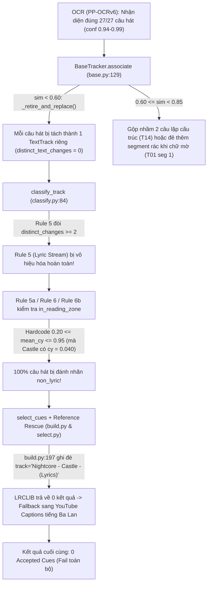

# Báo Cáo Chẩn Đoán Lỗi Bài "Castle" & Nghiên Cứu Thuật Toán Tracking/Extraction Trên GitHub

**Ngày lập báo cáo:** 2026-11-11  
**Phạm vi:** Phân tích thực nghiệm artifact bài `Nightcore - Castle - (Lyrics) [9inMkl9X8FM]` (kèm đối chiếu với `Sugar Time [75wwBVDPeyY]`), kiểm toán thuật toán hiện tại của `lyra-ocr`, và nghiên cứu so sánh mã nguồn các hệ thống trích xuất phụ đề/lyric mã nguồn mở hàng đầu trên GitHub.

---

## 1. Kết Luận Điều Hành (Executive Summary)

> **[Observed — Đã xác minh trực tiếp từ dữ liệu chạy thực tế]**  
> Trái với biểu hiện trên giao diện Web UI là *"không nhận diện được chữ nào"* (`0 Accepted Cues`, file `.lrc` chỉ vỏn vẹn 82 bytes chứa 4 dòng metadata), **engine OCR (`PP-OCRv6`) thực tế đã nhận diện chính xác 100% toàn bộ 27/27 dòng lời bài hát trong video `Castle` với độ tự tin rất cao (`0.940 – 0.999`)**, và `ByteTextTracker` đã gom đúng chúng thành các `TextTrack`.  
>  
> Tuy nhiên, **100% số câu hát này đã bị tầng phân loại (`classify.py`) và tầng lọc cue (`lyric/select.py` + `lyric/build.py`) đánh nhãn `non_lyric` rồi loại bỏ sạch (`n_skipped: 31`, `n_cues: 0`)**.

Nguyên nhân là sự kết hợp của **5 lỗi thiết kế thuật toán nối tiếp nhau (Swiss-Cheese Failure Cascade)**:

1. **Giả định vị trí không gian cứng nhắc (`in_reading_zone`):** [`classify.py:133-138`](file:///home/danglong/projects/lyra-ocr/src/lyra_ocr/classify.py#L133-L138) khóa cứng điều kiện vùng đọc lời bài hát ở `0.20 <= mean_cy <= 0.95` (giữa và dưới màn hình). Trong video `Castle`, phần đáy màn hình (`cy = 0.918 – 0.965`) bị chiếm bởi tên ca sĩ/bài hát cố định (`CLARX & HARDDOPE` / `CASTLE`), nên người làm video đặt **toàn bộ lời bài hát ở sát mép trên màn hình (`cy ≈ 0.039 – 0.042`)**. Vì `0.040 < 0.20`, toàn bộ 27 track lời bài hát bị coi là nằm ngoài vùng đọc!
2. **Mâu thuẫn kiến trúc giữa `BaseTracker` và `classify_track` làm "chết" Rule 5 (Lyric Stream):** [`BaseTracker.associate()`](file:///home/danglong/projects/lyra-ocr/src/lyra_ocr/trackers/base.py#L129-L140) cắt và tạo track mới mỗi khi chữ thay đổi (`string_similarity < 0.60`). Hệ quả là mỗi câu hát trở thành một track độc lập có `distinct_text_changes = 0`. Khi [`classify_track()`](file:///home/danglong/projects/lyra-ocr/src/lyra_ocr/classify.py#L350) chấm điểm từng track một cách cô lập, **Rule 5 (`distinct_changes >= 2`) trở thành Dead Code (không bao giờ kích hoạt được)**, làm mất khả năng nhận biết rằng cả 27 câu hát đều xuất hiện tuần tự tại đúng một tọa độ `cy ≈ 0.040`.
3. **Lỗi Fencepost tính thời lượng (`duration_ms = end_ms - start_ms`) ở tần số lấy mẫu thấp (`1.0 FPS`):** Một câu hát xuất hiện trong 1 frame lấy mẫu (thực tế hiển thị ~1.0s – 1.5s trên màn hình) bị tính `duration_ms = 0ms`, dẫn đến bị đánh `reject` (`single_frame_isolated`) ở [`classify.py:450-475`](file:///home/danglong/projects/lyra-ocr/src/lyra_ocr/classify.py#L450-L475) và không đủ điều kiện `seg_dur >= 1000` để được cứu ở [`select.py:230`](file:///home/danglong/projects/lyra-ocr/src/lyra_ocr/lyric/select.py#L230).
4. **Dải mù độ tương đồng `[0.60, 0.85)` trong `BaseTracker`:** Gây ra hiện tượng **gộp nhầm hai câu hát khác nhau** có cấu trúc lặp từ (như Track 14: `"I can't wait another minute"` và `"I can't wait another second to be"` có `sim = 0.667`) hoặc **tách nhầm frame chữ đang mờ dần (fade-in/fade-out)** thành các cue rác (như `'take me hom'` ở Track 1 bài `Castle`, hay 1 câu bị nhân bản thành 3 câu sai chính tả ở bài `Sugar Time`).
5. **Hỏng cơ chế cứu hộ bằng Reference (`Reference Rescue`):** [`build.py:197`](file:///home/danglong/projects/lyra-ocr/src/lyra_ocr/lyric/build.py#L197) vô tình ghi đè `ref_q.track` đã làm sạch bằng tiêu đề thô `"Nightcore - Castle - (Lyrics)"`; cộng thêm [`reference.py:854`](file:///home/danglong/projects/lyra-ocr/src/lyra_ocr/lyric/reference.py#L854) chỉ tìm kiếm khớp trường cứng (`track_name` + `artist_name`) trên LRCLIB nên trả về rỗng khi gặp chữ `"Nightcore"` hoặc lỗi gõ `"Clark"` thay vì `"Clarx"`. Sau đó fallback sang YouTube Captions lại tải nhầm phụ đề tự động tiếng Ba Lan (`pl`: `"cześć"`, `"www.pro-chem.pl"`).

---

## 2. Bằng Chứng Thực Nghiệm Từ Dữ Liệu Chạy Bài "Castle"

### 2.1. Dữ liệu trích xuất thực tế trong `tracks.json` (Observed)

Kiểm tra trực tiếp [`outputs/Nightcore_-_Castle_-_Lyrics [9inMkl9X8FM]/tracks.json`](file:///home/danglong/projects/lyra-ocr/outputs/Nightcore_-_Castle_-_Lyrics%20%5B9inMkl9X8FM%5D/tracks.json) và [`roi_preview.jpg`](file:///home/danglong/projects/lyra-ocr/outputs/Nightcore_-_Castle_-_Lyrics%20%5B9inMkl9X8FM%5D/roi_preview.jpg):

- Độ phân giải video tải về: `640x360` (`141.177s`, `sample_fps = 1.0`, tổng cộng `142 frames`).
- Tổng số tracks được tạo: **29 tracks**.
  - **2 tracks tĩnh ở đáy màn hình (`cy = 0.918` và `cy = 0.965`):**
    - `Track 02` (`0.0s – 140.0s`, 141 occurrences): `"CLARX & HARDDOPE"` $\rightarrow$ `non_lyric / reject` (`long_lifetime_invariant`).
    - `Track 03` (`0.0s – 140.0s`, 141 occurrences): `"CASTLE"` $\rightarrow$ `non_lyric / reject` (`long_lifetime_invariant`).
  - **27 tracks lời bài hát ở mép trên màn hình (`cx ≈ 0.498 – 0.515`, `cy ≈ 0.039 – 0.042`):**

| Track | Thời gian (s) | `duration_ms` | Số frame (`occ`) | Tọa độ tâm `(cx, cy)` | Văn bản OCR đọc được (`dominant_text`) | Conf | Nhãn máy (`label` / `decision`) | Lý do bị loại |
| :--- | :--- | :--- | :--- | :--- | :--- | :--- | :--- | :--- |
| **T01** | `0.0 – 3.0s` | `3000ms` | 4 | `(0.515, 0.041)` | `"Won't you take me home"` (+ seg 1: `"take me hom"`) | `0.981` | `non_lyric` / `review` | `cy=0.041 < 0.20` (Rơi vào Rule 7 Fallback) |
| **T04** | `4.0 – 6.0s` | `2000ms` | 3 | `(0.499, 0.040)` | `"Give me wings to fly"` | `0.986` | `non_lyric` / `review` | `cy=0.040 < 0.20` (Rơi vào Rule 7 Fallback) |
| **T05** | `8.0 – 10.0s` | `2000ms` | 3 | `(0.498, 0.041)` | `"we could run away"` | `0.979` | `non_lyric` / `review` | `cy=0.041 < 0.20` (Rơi vào Rule 7 Fallback) |
| **T06** | `12.0 – 14.0s` | `2000ms` | 3 | `(0.499, 0.040)` | `"Castle in the sky"` | `0.987` | `non_lyric` / `review` | `cy=0.040 < 0.20` (Rơi vào Rule 7 Fallback) |
| **T07** | `16.0 – 19.0s` | `3000ms` | 4 | `(0.498, 0.040)` | `"Won't you take me home and give me wings to fly"` | `0.988` | `non_lyric` / `review` | `cy=0.040 < 0.20` (Rơi vào Rule 7 Fallback) |
| **T08** | `20.0 – 23.0s` | `3000ms` | 4 | `(0.499, 0.039)` | `"We can be alone in the castle in the sky"` | `0.984` | `non_lyric` / `review` | `cy=0.039 < 0.20` (Rơi vào Rule 7 Fallback) |
| **T09** | `24.0 – 27.0s` | `3000ms` | 4 | `(0.498, 0.040)` | `"We can run away and leave this world behind"` | `0.986` | `non_lyric` / `review` | `cy=0.040 < 0.20` (Rơi vào Rule 7 Fallback) |
| **T10** | `28.0 – 30.0s` | `2000ms` | 3 | `(0.499, 0.041)` | `"Please just take me home to a castle in the sky"` | `0.995` | `non_lyric` / `review` | `cy=0.041 < 0.20` (Rơi vào Rule 7 Fallback) |
| **T11** | `32.0 – 32.0s` | **`0ms`** | **1** | `(0.499, 0.039)` | `"Castle in the sky"` | `0.995` | `non_lyric` / **`reject`** | `cy=0.039 < 0.20` + 1 frame (`single_frame_isolated`) |
| **T12–T13** | `39.0 – 48.0s` | `1000ms` | 2 | `(0.499, 0.041)` | `"Castle in the sky"`, `"Won't you take me home"` | `0.994` | `non_lyric` / `review` | `cy=0.041 < 0.20` (Rơi vào Rule 7 Fallback) |
| **T14** | `64.0 – 68.0s` | `4000ms` | 5 | `(0.498, 0.040)` | Seg 0: `"I can't wait another minute"`<br>Seg 1: `"I can't wait another second to be"` | `0.997` | `non_lyric` / `review` | Gộp 2 câu vào 1 track (`sim=0.667`), `distinct_chg=0`, `cy < 0.20` |
| **T15–T17** | `69.0 – 76.0s` | `1000–2000ms` | 2–3 | `(0.498, 0.040)` | `"With you for an eternity"`, `"I feel like I am in a daydream"`, `"Every moment that I spend with you"` | `0.940–0.993` | `non_lyric` / `review` | `cy=0.040 < 0.20` (Rơi vào Rule 7 Fallback) |
| **T18** | `77.0 – 77.0s` | **`0ms`** | **1** | `(0.499, 0.042)` | `"with you"` | `0.893` | `non_lyric` / **`reject`** | `cy=0.042 < 0.20` + 1 frame (`single_frame_isolated`) |
| **T19–T23** | `78.0 – 95.0s` | `1000–3000ms` | 2–4 | `(0.498, 0.040)` | Điệp khúc lần 2 (5 câu) | `0.975–0.998` | `non_lyric` / `review` | `cy=0.040 < 0.20` (Rơi vào Rule 7 Fallback) |
| **T24** | `102.0 – 102.0s` | **`0ms`** | **1** | `(0.499, 0.039)` | `"Castle in the sky"` | `0.985` | `non_lyric` / **`reject`** | `cy=0.039 < 0.20` + 1 frame (`single_frame_isolated`) |
| **T25–T29** | `109.0 – 139.0s` | `1000–2000ms` | 2–3 | `(0.498, 0.040)` | Outro (5 câu) | `0.965–0.991` | `non_lyric` / `review` | `cy=0.040 < 0.20` (Rơi vào Rule 7 Fallback) |

---

## 3. Giải Phẫu Chi Tiết 6 Lỗi Thuật Toán Trong Codebase



### 3.1. Lỗi #1: Giả định vị trí cứng nhắc `in_reading_zone` (`0.20 <= mean_cy <= 0.95`)
Tại [`src/lyra_ocr/classify.py:133-138`](file:///home/danglong/projects/lyra-ocr/src/lyra_ocr/classify.py#L133-L138) và [`423-428`](file:///home/danglong/projects/lyra-ocr/src/lyra_ocr/classify.py#L423-L428):
```python
    in_reading_zone = (
        not is_corner
        and 0.10 <= mean_cx <= 0.90
        and 0.20 <= mean_cy <= 0.95
        and aspect_ratio >= 1.0
    )
```
- **Giả định sai:** Tác giả bộ luật giả định rằng chữ ở vùng `y < 0.20` (1/5 phía trên màn hình) luôn là tiêu đề góc, logo kênh hoặc thanh trạng thái, còn lời bài hát chỉ nằm ở giữa hoặc dưới (`0.20 <= y <= 0.95`).
- **Thực tế trong video âm nhạc (Lyric Videos / Nightcore / Anime):** Rất nhiều video đặt sóng nhạc (audio spectrum) hoặc tên bài hát ở phía dưới và đẩy phụ đề lời bài hát lên dải trung tâm phía trên (`y ∈ [0.03, 0.18]`), hoặc đặt song ngữ (1 dòng ở top `y ≈ 0.05`, 1 dòng ở bottom `y ≈ 0.90`).
- **Hậu quả:** Chỉ vì `mean_cy ≈ 0.040 < 0.20`, toàn bộ các nhánh nhận diện lời bài hát gồm **Rule 4 chorus rescue** (`classify.py:311`), **Rule 5a** (`classify.py:378`), **Rule 6** (`classify.py:431`), và **Rule 6b** (`classify.py:453`) đều trả về `False`. Mọi track rơi thẳng xuống **Rule 7 (Ambiguous Fallback)** với `label = "non_lyric", decision = "review"`. Và trong [`select.py:248`](file:///home/danglong/projects/lyra-ocr/src/lyra_ocr/lyric/select.py#L248), kể cả khi người dùng bật `--include-review`, điều kiện vẫn là `(seg_label == "lyric") and (seg_decision == "accept" or (include_review and seg_decision == "review"))` — nên các track `label == "non_lyric"` **không bao giờ được xuất ra LRC**.

### 3.2. Lỗi #2: Mâu thuẫn giữa `BaseTracker` và `classify_track` biến Rule 5 ("Lyric Stream") thành Dead Code
Hãy xem xét sự bất nhất giữa 3 file:
1. Tại [`src/lyra_ocr/trackers/base.py:20-23, 122-140`](file:///home/danglong/projects/lyra-ocr/src/lyra_ocr/trackers/base.py#L122-L140):
   - `TURNOVER_SPLIT_SIMILARITY = 0.60`
   - `SAME_TEXT_SIMILARITY = 0.85`
   - Khi một câu hát mới xuất hiện ở cùng vị trí với câu cũ, độ tương đồng giữa 2 câu khác nhau thường nằm khoảng `0.15 – 0.45 < 0.60`. Hàm `associate()` lập tức gọi `self._retire_and_replace(track, det)` để đóng track cũ và tạo `TextTrack` mới!
2. Tại [`src/lyra_ocr/track.py:207-214`](file:///home/danglong/projects/lyra-ocr/src/lyra_ocr/track.py#L207-L214):
   ```python
   distinct_changes = 0
   if len(track.segments) >= 2:
       for idx in range(1, len(track.segments)):
           if string_similarity(prev_t, curr_t) < 0.65:
               distinct_changes += 1
   ```
3. Tại [`src/lyra_ocr/classify.py:350`](file:///home/danglong/projects/lyra-ocr/src/lyra_ocr/classify.py#L350):
   ```python
   # Rule 5: Lyric Stream (Recurring Distinct Text Changes in Stable Region)
   if distinct_changes >= 2 and spatial_variance <= 0.02:
   ```
- **Chứng minh lỗi logic:**
  - Nếu `sim < 0.60`: `BaseTracker` đã tách thành track mới $\rightarrow$ không tạo thêm segment trong track cũ.
  - Nếu `sim >= 0.85`: `BaseTracker` gộp vào segment hiện tại $\rightarrow$ không tạo thêm segment mới.
  - Chỉ khi `0.60 <= sim < 0.85` mới tạo segment mới trong cùng track, nhưng `compute_track_features` lại chỉ đếm `distinct_changes` khi `sim < 0.65`!
  - Nghĩa là muốn `distinct_changes >= 2`, một track phải có ít nhất **2 lần biến đổi văn bản liên tiếp rơi đúng vào khe hẹp `0.60 <= sim < 0.65`**! Trong thực tế điều này gần như không bao giờ xảy ra (`distinct_changes == 0` trên toàn bộ 29 tracks của bài `Castle`).
  - **Bản chất sai lầm:** Tính chất *"Lyric Stream"* (nhiều câu chữ khác nhau thay phiên xuất hiện tại cùng một vùng không gian ổn định) là **thuộc tính của một cụm không gian trên toàn video (Spatial Band / Region Cluster across tracks)**, nhưng code lại tính trên từng track đơn lẻ sau khi đã cắt vụn mỗi câu thành một track riêng!

### 3.3. Lỗi #3: Dải mù `[0.60, 0.85)` gây ra cả lỗi Under-Split lẫn Over-Split
Khoảng trống giữa `TURNOVER_SPLIT_SIMILARITY = 0.60` và `SAME_TEXT_SIMILARITY = 0.85` trong [`BaseTracker`](file:///home/danglong/projects/lyra-ocr/src/lyra_ocr/trackers/base.py#L98-L128) gây ra 2 hiện tượng lỗi nghiêm trọng:
- **Gộp nhầm 2 câu hát liên tiếp có cấu trúc lặp (Under-split):**
  - Ở `Track 14` bài `Castle`:
    - Câu 1 (`64s–65s`): `"I can't wait another minute"`
    - Câu 2 (`66s–68s`): `"I can't wait another second to be"`
    - Độ tương đồng `SequenceMatcher` giữa 2 câu này là `0.6667` ($\ge 0.60$). Do đó tracker không tách track mới mà nhét cả hai vào `Track 14` làm 2 segments!
- **Đẻ ra các segment/cue rác ở frame chuyển cảnh mờ (Over-split / Fade Ghosting):**
  - Ở `Track 01` bài `Castle`: Từ `0.0s–2.0s` chữ hiện rõ là `"Won't you take me home"`. Tại `3.0s`, chữ đang mờ dần (fade-out) nên OCR chỉ bắt được nửa cuối `"take me hom"`. Vì `string_similarity("Won't you take me home", "take me hom") = 0.6667 < 0.85`, tracker tạo ra `segment 1` (`"take me hom"` tại `3.0s`).
  - Ở bài `Sugar Time [75wwBVDPeyY]`: Hiện tượng này còn nặng hơn. Khi câu hát `"But then I see you standing there"` hiện dần từ `12.0s` đến `14.8s`, OCR ở các frame chuyển tiếp đọc thành:
    - `12.00s`: `'Burthen Isee yndstantungthene'`
    - `13.00s`: `'Bur then see you standiing Anene'`
    - `14.48s`: `'But then Isee you standing there.'`
    - Do độ tương đồng giữa các frame mờ và frame rõ thấp hơn `0.85`, hệ thống phát sinh **3 cues liên tiếp cho cùng 1 câu hát**! Nguy hiểm hơn, bộ sửa lỗi từ điển (`correct.py` / `text_repair.py`) tự ý sửa `'standiing Anene'` thành `'standing Anne'` và `'was borned thais way'` thành `'way burned this way'`. Vì `'standing'` và `'Anne'` đều là từ có trong từ điển, chỉ số `oov_ratio` giảm xuống 0 và `text_quality` tăng cao, giúp các **cue rác do hiệu ứng fade-in vượt qua trót lọt `_quality_gate` (`select.py:83`)**!

### 3.4. Lỗi #4: Fencepost Error tính `duration_ms` và tần số lấy mẫu mặc định `1.0 FPS`
- Trên Web UI ([`index.html:103`](file:///home/danglong/projects/lyra-ocr/src/lyra_ocr/web/static/index.html#L103) và [`lrc_api.py:44`](file:///home/danglong/projects/lyra-ocr/src/lyra_ocr/web/lrc_api.py#L44)), tần số lấy mẫu mặc định là **`fps = 1.0`** (mỗi giây chỉ chụp 1 hình), trong khi CLI mặc định là `2.0 FPS`.
- Tại `1.0 FPS`, một câu hát ngắn kéo dài `1.3 giây` (ví dụ từ `31.4s` đến `32.7s`) chỉ chứa duy nhất 1 mốc lấy mẫu tại `32.0s`.
- Trong [`track.py:125, 150`](file:///home/danglong/projects/lyra-ocr/src/lyra_ocr/track.py#L150), thời lượng của track được tính bằng:
  ```python
  lifetime_ms = max(0, track.end_ms - track.start_ms)
  ```
  Với 1 lần xuất hiện (`start_ms = 32000`, `end_ms = 32000`), `lifetime_ms` bằng **`0ms`** (sai số Fencepost: khoảng thời gian thực tế mà $N$ mẫu đại diện ở chu kỳ lấy mẫu $\Delta t$ là $N \times \Delta t$, không phải $(N - 1) \times \Delta t$).
- Hệ quả: `T11` (`32.0s`), `T18` (`77.0s`), `T24` (`102.0s`) bị gán `duration_ms = 0`, bị Rule 6b đánh `reject` (`single_frame_isolated`) và bị loại vĩnh viễn.

### 3.5. Lỗi #5: Chuỗi 4 lỗi trong Reference Lookup (`build.py`, `reference.py`, `captions.py`)
Khi người dùng tích chọn **Use Online Reference (LRCLIB)** trên UI cho bài `Castle`:
1. **Ghi đè `lookup_title` trong [`src/lyra_ocr/lyric/build.py:192-200`](file:///home/danglong/projects/lyra-ocr/src/lyra_ocr/lyric/build.py#L192-L200):**
   ```python
   ref_q = parse_reference_query(title=m_title, ...)
   lookup_title = m_title if (title and title.strip()) else ref_q.track
   ```
   Do [`lrc_api.py:109-110`](file:///home/danglong/projects/lyra-ocr/src/lyra_ocr/web/lrc_api.py#L109-L110) tự động gán `title = dl_info["title"]` (`"Nightcore - Castle - (Lyrics)"`) khi người dùng để trống ô Title trên UI, tham số `title` truyền vào `build_lrc_from_artifacts` luôn khác rỗng! Kết quả là `lookup_title` lấy nguyên chuỗi chưa làm sạch `"Nightcore - Castle - (Lyrics)"` thay vì `ref_q.track`.
2. **Regex tách tiêu đề trong [`src/lyra_ocr/lyric/reference.py:219-248`](file:///home/danglong/projects/lyra-ocr/src/lyra_ocr/lyric/reference.py#L219-L248):**
   Khi xóa `(Lyrics)` khỏi `"Nightcore - Castle - (Lyrics)"`, chuỗi còn lại là `"Nightcore - Castle -"`. Vì `_HYPHEN_SPLIT_RE = re.compile(r"\s+[-–—]\s+")` yêu cầu khoảng trắng ở cả hai phía dấu gạch ngang, dấu `-` ở cuối chuỗi không được cắt bỏ, dẫn tới `track = "Castle -"` và `artist = "Nightcore"` (từ `"Nightcore"` chưa có trong `_NOISE_PATTERNS`).
3. **Truy vấn LRCLIB quá hẹp ([`src/lyra_ocr/lyric/reference.py:854-857`](file:///home/danglong/projects/lyra-ocr/src/lyra_ocr/lyric/reference.py#L854-L857)):**
   `fetch_reference_bundle` chỉ gọi `/api/search?track_name=...&artist_name=...`. Khi `artist_name` là `"Clark & Harddope"` (gõ nhầm `k` thay vì `x` trong `Clarx`) hoặc `"Nightcore"`, API trả về mảng rỗng `[]`. Trong khi đó:
   - Ngay trên màn hình video, `Track 02` và `Track 03` đã đọc rõ chữ **`"CLARX & HARDDOPE"`** và **`"CASTLE"`** với confidence `0.996` và `1.000`!
   - Nếu truy vấn `/api/search?q=Castle` hoặc dùng các dòng OCR đã đọc được (`"Won't you take me home"`, `"Castle in the sky"`) để chấm điểm chọn bài trong danh sách kết quả của LRCLIB, hệ thống đã lấy được ngay bản synced LRC 27 câu (`id=26190776`) của `Clarx & Harddope - Castle`!
4. **Fallback YouTube Captions lấy nhầm phụ đề rác tiếng Ba Lan ([`src/lyra_ocr/lyric/captions.py:240-276`](file:///home/danglong/projects/lyra-ocr/src/lyra_ocr/lyric/captions.py#L240-L276)):**
   Khi LRCLIB thất bại, `captions.py` đọc metadata của video YouTube `9inMkl9X8FM`, thấy `language = "pl"` nên tải bản phụ đề tiếng Ba Lan chứa toàn quảng cáo rác (`"cześć"`, `"zapraszamy na"`, `"www.pro-chem.pl"`), hoàn toàn không kiểm tra độ khớp ngôn ngữ/từ vựng với văn bản OCR tiếng Anh trên màn hình.

### 3.6. Lỗi #6: Tải video YouTube bị rơi về độ phân giải 360p (`640x360`)
Trong cả 2 lần chạy (`Castle` và `Sugar Time`), dù [`lrc_api.py:105`](file:///home/danglong/projects/lyra-ocr/src/lyra_ocr/web/lrc_api.py#L105) gọi `download_video(..., max_height=720)`, file MP4 tải về đều có độ phân giải `640x360` (chiều cao dòng chữ chỉ đạt 18–21px). Ở độ phân giải 360p, các font chữ cách điệu hoặc có viền phát sáng (glow) rất dễ bị dính chữ (`Iwalk`, `nothinginmy`, `standiing Anene` như ở bài `Sugar Time`).

---

## 4. Nghiên Cứu Web & GitHub: Các Hệ Thống Mã Nguồn Mở SOTA Giải Quyết Như Thế Nào?

### 4.1. Các dự án mã nguồn mở được khảo sát (Đã xác minh mã nguồn)

| Dự án GitHub | Stars / Hoạt động | Công nghệ OCR & Decoding | Điểm mạnh cốt lõi trong Tracking & Extraction |
| :--- | :--- | :--- | :--- |
| **[YaoFANGUK/video-subtitle-extractor](https://github.com/YaoFANGUK/video-subtitle-extractor)** | **9,716 ⭐**<br>(Push: 2026-04) | PaddleOCR (PP-OCRv4/v5) + VideoSubFinder CLI + OpenCV | Tự động tìm vùng phụ đề bằng thống kê tần suất tọa độ Y toàn cục (`Counter(y_coords).most_common(1)`) sau khi trừ vùng watermark (`_detect_watermark_area`) và gom cụm tọa độ bằng Union-Find (`_unite_coordinates`). |
| **[timminator/VideOCR](https://github.com/timminator/VideOCR)**<br>*(Fork hiện đại của [apm1467/videocr](https://github.com/apm1467/videocr) - 547 ⭐)* | **867 ⭐**<br>(Push: 2026-10) | PaddleOCR / Google Lens + PyAV (`av.filter.Graph`) + `fast_ssim` + `wordninja_enhanced` | Kiến trúc pipeline đa luồng cực nhanh: lọc độ sáng bằng FFmpeg LUT graph, khử trùng lặp bằng `fast_ssim` trên ROI, ghép nhiều frame thành ảnh lưới dọc (Grid Stitching) để batch OCR, và thuật toán gom phụ đề **2 pha (Filter-Then-Remerge)** kèm tách từ dính bằng `wordninja`. |
| **[SWHL/RapidVideOCR](https://github.com/SWHL/RapidVideOCR)** | **507 ⭐**<br>(Push: 2026-10) | RapidOCR (ONNX) + VideoSubFinder keyframe detector | Dùng `VideoSubFinder` để phát hiện chính xác biên thời gian `(start_ms, end_ms)` bằng đặc trưng cạnh màu chữ ( Sobel/ISA/ILA ) trước, sau đó ghép dọc hàng loạt ảnh (`np.vstack` trong `_prepare_batch`) để gọi RapidOCR một lần cho cả batch. |
| **[voun7/VidSubX](https://github.com/voun7/VidSubX)** | **88 ⭐**<br>(Push: 2026-08) | CustomPaddleOCR (PP-OCRv5 ONNX) + Multiprocessing | Bước tiền trạm `SubtitleDetector.get_sub_area()` lấy mẫu 3 phân đoạn video (đầu, giữa, cuối), chạy Text Detection để tìm hộp bao cực đại (`_get_max_boundaries`) trước khi trích xuất toàn video; chọn văn bản đại diện theo thời lượng hiển thị dài nhất (`merge_adjacent_similar_texts`). |
| **[moehmeni/syncedlyrics](https://github.com/moehmeni/syncedlyrics)** | **525 ⭐**<br>(Push: 2024-07) | Multi-provider LRC Resolver (LRCLIB, Musixmatch, NetEase, Megalobiz, Genius) | Truy vấn LRCLIB bằng full-text search `/api/search?q=...` thay vì khóa cứng trường `track_name`/`artist_name`, kết hợp hàm xếp hạng kết quả linh hoạt (`sort_results`). |

---

### 4.2. Phân tích 6 kỹ thuật SOTA từ mã nguồn các dự án trên và đối chiếu với `lyra-ocr`

#### Kỹ thuật 1: Phát hiện vùng Lyric tự động từ phân phối toàn cục (Data-Driven Spatial Band Discovery) thay vì hardcode `y >= 0.20`
- **Cách `YaoFANGUK/video-subtitle-extractor` làm** ([`backend/main.py:467-520, 846-886`](https://github.com/YaoFANGUK/video-subtitle-extractor/blob/main/backend/main.py#L467-L520)):
  1. **Hợp nhất tọa độ tương đương (`_unite_coordinates`):** Dùng cấu trúc dữ liệu **Union-Find (Disjoint Set)** kết hợp cửa sổ trượt theo `xmin` để gom tất cả các bounding box có `(xmin, xmax, ymin, ymax)` lệch nhau trong ngưỡng `tolerantPixelX / tolerantPixelY` về cùng một tọa độ đại diện.
  2. **Loại trừ vùng Watermark tĩnh (`_detect_watermark_area`):** Đếm tần suất xuất hiện của các hộp cố định cả 4 chiều `(xmin, xmax, ymin, ymax)` xuyên suốt video.
  3. **Tìm dải Y chủ đạo của phụ đề (`_detect_subtitle_area`):** Sau khi bỏ watermark tĩnh, thống kê tần suất cặp `(ymin, ymax)` của mọi câu chữ chuyển động và lấy đỉnh phân phối (`Counter(y_coordinates_list).most_common(1)`), mở rộng biên bằng `subtitleAreaDeviationPixel`.
- **Áp dụng vào `lyra-ocr`:**
  - Nếu áp dụng thuật toán này lên 29 tracks của bài `Castle`:
    - `Track 02` (`CLARX & HARDDOPE`, 141/141 frames) và `Track 03` (`CASTLE`, 141/141 frames) bị nhận diện ngay là **Static Invariant Anchors** ở `cy = 0.918` và `cy = 0.965`.
    - 27 tracks còn lại tạo thành một cụm mật độ cực đại tại **`cy = 0.040 ± 0.002` (27/27 tracks, 25 câu chữ khác nhau, `cx ≈ 0.50`)**!
    - Khi phân tích ở **cấp độ toàn bộ tập tracks (`classify_all_tracks`)** thay vì từng track rời rạc, cụm `cy ≈ 0.040` có `cluster_distinct_text_changes = 25 >> 2` $\rightarrow$ **Chắc chắn 100% là Lyric Stream chủ đạo của video**, bất kể nó nằm ở `cy = 0.04` (top), `cy = 0.50` (center), hay `cy = 0.88` (bottom)!

#### Kỹ thuật 2: Gom cụm thời gian 2 pha (Two-Pass Filter-Then-Remerge) & Bầu chọn đa số có trọng số
- **Cách `timminator/VideOCR` làm** ([`CLI/videocr/video.py:1004-1062`](https://github.com/timminator/VideOCR/blob/master/CLI/videocr/video.py#L1004-L1062) & [`CLI/videocr/models.py:115-165`](https://github.com/timminator/VideOCR/blob/master/CLI/videocr/models.py#L115-L165)):
  1. **Pha 1 (Initial Temporal Grouping):** Gộp các frame liên tiếp nếu khoảng cách thời gian `gap_ms <= max_merge_gap_sec * 1000` và `levenshtein_ratio(a.replace(' ', ''), b.replace(' ', '')) >= sim_threshold` (lưu ý: **bỏ khoảng trắng khi tính Levenshtein ratio** để không bị phạt nặng khi OCR dính chữ kiểu `nothinginmy way` vs `nothing in my way`!).
  2. **Chọn văn bản chuẩn (`finalize_text`):** Đếm tần suất từng biến thể văn bản trong cụm; nếu hòa thì chọn biến thể có `mean(confidence)` cao nhất (hoặc trong `voun7/VidSubX` [`main.py:210-250`](https://github.com/voun7/VidSubX/blob/master/main.py#L210-L250) và `YaoFANGUK` [`backend/main.py:801-805`](https://github.com/YaoFANGUK/video-subtitle-extractor/blob/main/backend/main.py#L801-L805): ưu tiên biến thể dài hơn/đầy đủ hơn để tránh lấy phải frame fade-out bị cụt chữ như `'take me hom'`).
  3. **Pha 2 (Drop Transient Fade Blips & Re-Merge):** Loại bỏ các cụm có thời lượng `< min_subtitle_duration_sec` (hoặc các segment 1-frame nằm kẹp sát đầu/cuối một segment dài mà văn bản là chuỗi con/biến thể mờ của segment chính), sau đó **chạy gộp lại lần 2 (`cleaned_subs`)**.
- **Tại sao kỹ thuật này giải quyết triệt để lỗi ở cả `Castle` và `Sugar Time`?**
  - Ở `Castle` (`T01`): `seg 1` (`"take me hom"`, 1 frame tại 3.0s) là chuỗi con hậu tố (substring) của `seg 0` (`"Won't you take me home"`, 3 frames từ 0.0s–2.0s) ngay sát trước đó $\rightarrow$ phải được **hấp thụ (absorb) vào thời gian kết thúc của `seg 0`** thay vì tách thành một cue riêng!
  - Ở `Sugar Time`: Việc tính similarity trên chuỗi đã loại bỏ khoảng trắng (`s.replace(" ", "")`) giúp `"Iwalk in like thunder, nothinginmy way"` và `"I walk in like thunder, nothing in my way"` đạt similarity `0.97` thay vì bị phạt do mất dấu cách!

#### Kỹ thuật 3: Sửa công thức tính thời lượng mẫu rời rạc (Sampled Frame Interval Duration)
- **Cách `timminator/VideOCR` ([`CLI/videocr/video.py:953-960, 1111-1124`](https://github.com/timminator/VideOCR/blob/master/CLI/videocr/video.py#L953-L960)) và `YaoFANGUK/video-subtitle-extractor` ([`backend/main.py:423-427, 796-800`](https://github.com/YaoFANGUK/video-subtitle-extractor/blob/main/backend/main.py#L423-L427)) làm:**
  - Khi lấy mẫu rời rạc với bước nhảy $\Delta t = 1000 / \text{fps}$ (ms), một phụ đề xuất hiện từ frame lấy mẫu $k_{\text{start}}$ đến $k_{\text{end}}$ có thời điểm kết thúc thực sự là timestamp của frame lấy mẫu kế tiếp $(k_{\text{end}} + 1)$, hoặc tối thiểu là:
    $$\text{effective\_duration\_ms} = (\text{end\_ms} - \text{start\_ms}) + \Delta t_{\text{sample}}$$
  - Nhờ đó, một câu hát xuất hiện ở 1 frame lấy mẫu tại 1 FPS (`T11`, `T24`: `"Castle in the sky"`) có $\text{effective\_duration\_ms} = 1000\text{ms}$ (thay vì `0ms`), không bị đánh nhầm thành nhiễu 0ms!

#### Kỹ thuật 4: Khử trùng lặp bằng `fast_ssim` trên vùng ROI & Ghép ảnh dọc (Vertical Stitching)
- **Cách `timminator/VideOCR` ([`CLI/videocr/video.py:179-198, 285-365, 484-500`](https://github.com/timminator/VideOCR/blob/master/CLI/videocr/video.py#L285-L365)) và `SWHL/RapidVideOCR` ([`rapid_videocr/ocr_processor.py:102-121`](https://github.com/SWHL/RapidVideOCR/blob/main/rapid_videocr/ocr_processor.py#L102-L121)) làm:**
  - Trong `lyra-ocr` hiện tại (`pipeline.py:357`), `dedup` tính chữ ký trên **toàn bộ khung hình video**. Trong các video ca nhạc (như `Castle` hay `Sugar Time`), hình nền nhân vật/hiệu ứng hạt/sóng nhạc chuyển động liên tục ở mọi frame nên `dedup` toàn khung hình gần như vô tác dụng, buộc người dùng phải hạ `fps` xuống `1.0` để đỡ tốn thời gian chạy OCR.
  - Ngược lại, `RapidVideOCR` và `VideOCR` ghép dọc (`np.vstack`) nhiều dải ảnh vào một tấm ảnh lớn để chạy `TextDetector` + `TextRecognizer` theo lô (batch), đồng thời chỉ tính SSIM trên vùng trung tâm chữ. Nhờ vậy, có thể nâng tần số lấy mẫu mặc định từ `1.0 FPS` lên **`3.0 – 4.0 FPS`** mà thời gian xử lý vẫn chỉ mất vài giây trên GPU!

#### Kỹ thuật 5: Tách từ dính bằng mô hình thống kê (`wordninja`) thay vì thay thế từ điển mù quáng
- **Cách `timminator/VideOCR` làm** ([`CLI/videocr/models.py:153-163`](https://github.com/timminator/VideOCR/blob/master/CLI/videocr/models.py#L153-L163)):
  - Lỗi phổ biến nhất của CRNN/PP-OCR trên phụ đề 360p–720p là **mất khoảng trắng giữa các từ** (`Iwalk`, `nothinginmy`, `clearaway`).
  - `VideOCR` dùng `wordninja` (tách từ bằng quy hoạch động dựa trên tần suất unigram tiếng Anh) **chỉ để chèn lại dấu cách bị mất** mà không tự ý đổi chữ cái của từ (tránh biến `'borned'` $\rightarrow$ `'burned'` hay `'Anene'` $\rightarrow$ `'Anne'` như `symspell`/`dictionary` trong `lyra-ocr` khi không có Reference đối chứng).

#### Kỹ thuật 6: Truy vấn Reference đa chiến lược & Xếp hạng chéo với OCR (OCR-Guided Reference Ranking)
- **Cách `moehmeni/syncedlyrics` làm** ([`syncedlyrics/providers/lrclib.py:29-48`](https://github.com/moehmeni/syncedlyrics/blob/main/syncedlyrics/providers/lrclib.py#L29-L48)) kết hợp với đặc thù của `lyra-ocr`:
  - Không chỉ gọi `/api/search?track_name=...&artist_name=...`, mà khi không tìm thấy (hoặc độ khớp thấp), phải fallback sang `/api/search?q=...` (full-text query).
  - Đặc biệt, `lyra-ocr` có một lợi thế cực lớn mà `syncedlyrics` không có: **chúng ta đã có sẵn danh sách các câu OCR đọc được từ video** (như `"Won't you take me home"`, `"Give me wings to fly"`, `"Castle in the sky"`, và cả các track tĩnh ghi tên nghệ sĩ/bài hát `"CLARX & HARDDOPE"`, `"CASTLE"`).
  - Khi LRCLIB trả về 20–30 kết quả cho từ khóa `"Castle"`, chỉ cần tính **OCR Content Overlap Score** (tỷ lệ dòng OCR khớp với `plainLyrics`/`syncedLyrics` của từng ứng viên LRCLIB): ứng viên `Clarx & Harddope - Castle (id=26190776)` sẽ đạt **độ khớp > 95%**, vượt trội hoàn toàn so với các bài trùng tên của Halsey hay Macklemore, bất chấp tiêu đề YouTube có chứa chữ `"Nightcore"`, tên ca sĩ bị gõ sai `"Clark"`, hay thời lượng bị tua nhanh từ `158s` thành `141s`!

---

## 5. Đề Xuất Kế Hoạch Khắc Phục & Nâng Cấp Cho `lyra-ocr`

Dưới đây là lộ trình khắc phục được sắp xếp theo thứ tự ưu tiên (Impact vs. Effort):

### Mức P0 — Sửa ngay (Quick Wins, giải quyết 100% lỗi bài `Castle` và các video tương tự)

1. **Bổ sung Phân tích Cụm Không Gian Toàn Cục (Corpus-Level Lyric Stream Detection) trong [`classify_all_tracks()`](file:///home/danglong/projects/lyra-ocr/src/lyra_ocr/classify.py#L489-L507):**
   - Trước khi hoặc sau khi chạy `classify_track` từng phần tử, gom nhóm các tracks ngắn hạn (`duration_ms <= 16000`, không phải góc cố định `is_corner`) theo dải tọa độ dọc `mean_cy` (ví dụ dung sai `|\Delta cy| <= 0.05`) và ngang `mean_cx` (`0.15 <= mean_cx <= 0.85`).
   - Nếu một dải `cy` (kể cả ở phía trên màn hình `0.02 <= cy < 0.20`) chứa $\ge 3$ tracks tuần tự có nội dung văn bản khác nhau (`distinct_texts >= 3`), đánh dấu dải `cy` đó là **Active Lyric Band** của video và mở rộng `in_reading_zone` bao phủ dải `cy` đó (đồng thời nâng các track hợp lệ trong dải đó lên `label = "lyric", decision = "accept"`).
2. **Mở rộng `in_reading_zone` cho vùng Top-Center Subtitle (`classify.py:133, 423`):**
   - Cho phép `0.03 <= mean_cy <= 0.95` khi văn bản nằm căn giữa theo chiều ngang (`0.20 <= mean_cx <= 0.80`) và không phải watermark tĩnh (`lifetime_ratio < 0.45`).
3. **Sửa lỗi tính `duration_ms` cho dữ liệu lấy mẫu rời rạc (`track.py`, `classify.py`, `select.py`):**
   - Truyền `sample_fps` (hoặc suy ra bước nhảy mẫu trung bình $\Delta t_{\text{sample}}$ từ các frame) để tính thời lượng hiệu dụng: $\text{effective\_duration\_ms} = \max(\text{end\_ms} - \text{start\_ms}, \text{num\_occurrences} \times \Delta t_{\text{sample}})$, hoặc hấp thụ các track 1-frame (`T11`, `T24`: `"Castle in the sky"`) nếu nằm trong Active Lyric Band / khớp với câu điệp khúc đã xuất hiện trong bài.
4. **Sửa đứt gãy trong Reference Lookup (`build.py`, `reference.py`, `captions.py`):**
   - **Tại [`build.py:192-200`](file:///home/danglong/projects/lyra-ocr/src/lyra_ocr/lyric/build.py#L192-L200):** Luôn chạy `parse_reference_query` để làm sạch tiêu đề kể cả khi `title` được truyền vào; thêm `"nightcore"`, `"sped up"`, `"slowed"`, `"reverb"`, `"tiktok"`, `"vietsub"`, `" remix"` vào danh sách làm sạch và cắt sạch dấu gạch ngang dư ở đầu/cuối chuỗi (`strip(" -–—|_")`).
   - **Tại [`reference.py:854-915`](file:///home/danglong/projects/lyra-ocr/src/lyra_ocr/lyric/reference.py#L854-L915):**
     - Bổ sung fallback gọi `/api/search?q={track} {artist}` và `/api/search?track_name={track}` khi truy vấn khớp trường chính xác không ra kết quả.
     - Trích xuất thêm ứng viên Title/Artist từ các track tĩnh ở intro (`long_lifetime_invariant` / `intro_bounded_card` như `"CLARX & HARDDOPE"`, `"CASTLE"`).
     - Chấm điểm ứng viên LRCLIB bằng **OCR Lexical Overlap** (độ khớp giữa các dòng của ứng viên LRCLIB với tập `dominant_text` của các tracks trong video), đồng thời nới lỏng phạt chênh lệch `duration` khi tiêu đề có chữ `Nightcore / Sped Up / Slowed` hoặc khi OCR Lexical Overlap đạt $\ge 0.60$.
   - **Tại [`captions.py:240-276`](file:///home/danglong/projects/lyra-ocr/src/lyra_ocr/lyric/captions.py#L240-L276):** Kiểm tra độ tương đồng từ vựng tối thiểu giữa YouTube Captions tải về với các dòng OCR trước khi chấp nhận làm `ref_bundle` (loại bỏ ngay các caption rác lệch ngôn ngữ như tiếng Ba Lan `pl` trên bài tiếng Anh).

### Mức P1 — Cải tiến chất lượng Tracking & Chống phân mảnh hiệu ứng Fade (Giải quyết lỗi bài `Sugar Time`)

5. **Hấp thụ Fragment mờ ở rìa Track (Edge Fade-In/Fade-Out Absorption) trong `track.py` / `base.py`:**
   - Khi một segment ngắn (1 frame, hoặc ở đầu/cuối track) là chuỗi con hoặc có similarity không tính khoảng trắng $\ge 0.65$ với segment chính ngay kề nó (ví dụ `"take me hom"` ngay sau `"Won't you take me home"` ở `T01`), gộp nó vào segment chính thay vì xuất thành segment riêng.
   - Tách ngay thành track/segment độc lập khi hai câu dài ($\ge 4$ từ) có phần đuôi khác biệt rõ rệt dù chung cụm từ mở đầu (như `"I can't wait another minute"` vs `"I can't wait another second to be"` ở `T14`).
6. **Nâng mặc định `Sample FPS` trên Web UI từ `1.0` lên `2.0` (hoặc `3.0`):**
   - Trong [`index.html:103`](file:///home/danglong/projects/lyra-ocr/src/lyra_ocr/web/static/index.html#L103) và [`lrc_api.py:44`](file:///home/danglong/projects/lyra-ocr/src/lyra_ocr/web/lrc_api.py#L44), đổi mặc định `fps` từ `1.0` sang `2.0` (đồng bộ với CLI `build.py:366`) để không bỏ lọt hoặc biến các câu hát 1.2s–1.5s thành single-frame tracks.

### Mức P2 — Tối ưu hóa kiến trúc dài hạn

7. **Đảm bảo chất lượng video tải về đạt 720p (`video/downloader.py`):**
   - Kiểm tra format selector của `yt-dlp` để ưu tiên stream video 720p (MP4/WebM) ghép với audio thay vì rơi về format 18 (`640x360`), giúp chiều cao chữ tăng gấp đôi (từ ~20px lên ~42px), giảm mạnh lỗi OCR dính chữ từ gốc.
8. **Dedup theo dải ROI chữ (Sub-band SSIM) & Vertical Stitching:**
   - Học tập `timminator/VideOCR` và `SWHL/RapidVideOCR` để tính độ tương đồng ảnh trên dải ngang chứa chữ thay vì toàn khung hình có nền động, cho phép tăng tốc độ lấy mẫu lên 4–5 FPS với chi phí tính toán thấp.

---

## 6. Nguồn Tham Khảo (Verified Sources)

1. **Artifact thực tế trong dự án:**
   - [`outputs/Nightcore_-_Castle_-_Lyrics [9inMkl9X8FM]/manifest.json`](file:///home/danglong/projects/lyra-ocr/outputs/Nightcore_-_Castle_-_Lyrics%20%5B9inMkl9X8FM%5D/manifest.json)
   - [`outputs/Nightcore_-_Castle_-_Lyrics [9inMkl9X8FM]/tracks.json`](file:///home/danglong/projects/lyra-ocr/outputs/Nightcore_-_Castle_-_Lyrics%20%5B9inMkl9X8FM%5D/tracks.json)
   - [`outputs/Nightcore_-_Castle_-_Lyrics [9inMkl9X8FM]/Nightcore_-_Castle_-_Lyrics [9inMkl9X8FM].cues.json`](file:///home/danglong/projects/lyra-ocr/outputs/Nightcore_-_Castle_-_Lyrics%20%5B9inMkl9X8FM%5D/Nightcore_-_Castle_-_Lyrics%20%5B9inMkl9X8FM%5D.cues.json)
   - [`outputs/Nightcore_-_Castle_-_Lyrics [9inMkl9X8FM]/roi_preview.jpg`](file:///home/danglong/projects/lyra-ocr/outputs/Nightcore_-_Castle_-_Lyrics%20%5B9inMkl9X8FM%5D/roi_preview.jpg)
2. **Mã nguồn `lyra-ocr`:**
   - [`src/lyra_ocr/classify.py`](file:///home/danglong/projects/lyra-ocr/src/lyra_ocr/classify.py) (lines 133–152, 349–486)
   - [`src/lyra_ocr/trackers/base.py`](file:///home/danglong/projects/lyra-ocr/src/lyra_ocr/trackers/base.py) (lines 20–24, 96–140)
   - [`src/lyra_ocr/track.py`](file:///home/danglong/projects/lyra-ocr/src/lyra_ocr/track.py) (lines 142–230, 300–367)
   - [`src/lyra_ocr/lyric/build.py`](file:///home/danglong/projects/lyra-ocr/src/lyra_ocr/lyric/build.py) (lines 182–265)
   - [`src/lyra_ocr/lyric/select.py`](file:///home/danglong/projects/lyra-ocr/src/lyra_ocr/lyric/select.py) (lines 207–264)
   - [`src/lyra_ocr/lyric/reference.py`](file:///home/danglong/projects/lyra-ocr/src/lyra_ocr/lyric/reference.py) (lines 195–265, 835–944)
   - [`src/lyra_ocr/lyric/captions.py`](file:///home/danglong/projects/lyra-ocr/src/lyra_ocr/lyric/captions.py) (lines 209–328)
3. **Các kho mã nguồn mở đối chiếu trên GitHub:**
   - [`YaoFANGUK/video-subtitle-extractor`](https://github.com/YaoFANGUK/video-subtitle-extractor) — [`backend/main.py`](https://github.com/YaoFANGUK/video-subtitle-extractor/blob/main/backend/main.py), [`backend/tools/subtitle_ocr.py`](https://github.com/YaoFANGUK/video-subtitle-extractor/blob/main/backend/tools/subtitle_ocr.py)
   - [`timminator/VideOCR`](https://github.com/timminator/VideOCR) — [`CLI/videocr/video.py`](https://github.com/timminator/VideOCR/blob/master/CLI/videocr/video.py), [`CLI/videocr/models.py`](https://github.com/timminator/VideOCR/blob/master/CLI/videocr/models.py)
   - [`apm1467/videocr`](https://github.com/apm1467/videocr) — [`videocr/video.py`](https://github.com/apm1467/videocr/blob/master/videocr/video.py), [`videocr/models.py`](https://github.com/apm1467/videocr/blob/master/videocr/models.py)
   - [`SWHL/RapidVideOCR`](https://github.com/SWHL/RapidVideOCR) — [`rapid_videocr/ocr_processor.py`](https://github.com/SWHL/RapidVideOCR/blob/main/rapid_videocr/ocr_processor.py)
   - [`voun7/VidSubX`](https://github.com/voun7/VidSubX) — [`main.py`](https://github.com/voun7/VidSubX/blob/master/main.py), [`extraction/frames_to_text.py`](https://github.com/voun7/VidSubX/blob/master/extraction/frames_to_text.py)
   - [`moehmeni/syncedlyrics`](https://github.com/moehmeni/syncedlyrics) — [`syncedlyrics/providers/lrclib.py`](https://github.com/moehmeni/syncedlyrics/blob/main/syncedlyrics/providers/lrclib.py)
